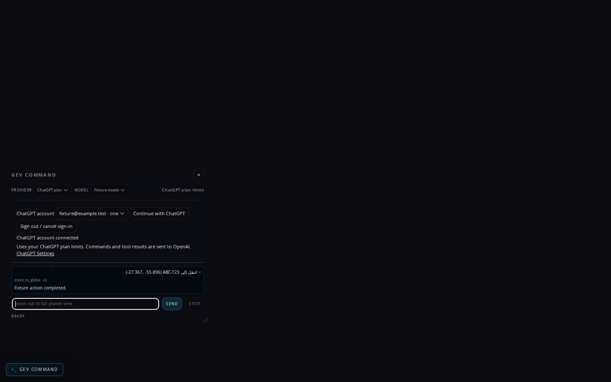
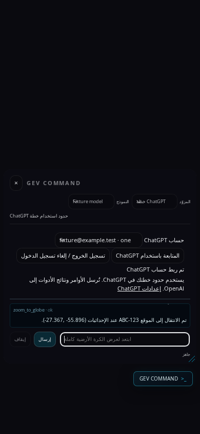

# GEV COMMAND on Vue / Pinia

Integration candidate for #1331, 2026-11-02. Base: upstream main
`151ce3dee72426193a85af71105ddcf62b7f2c28`, including the Vue migration
#1499 (`accfa1fa855d8dd0a2a655ccaac226a38d59fabd`). The existing PR remains
the contribution; no replacement PR is needed.

## Ownership and mounting

- `index.html` places `data-gev-view="agent-console"` beside the other page
  views. `mountApplicationViews()` renders `AgentConsoleView.vue` before
  `createApplicationTools()` wires `mountAgentConsole()`. Hosts may omit the
  view through the existing `omitViews` API. The retired build-time HTML
  expander and `agent-console.html` are not used.
- `gev-agent-console` is a presentation store on the page's shared Pinia.
  Vue renders provider/model options, cost, busy/STOP states, transcript rows,
  account controls, the popup fallback link and translated labels. Neither
  controller builds children inside Vue-owned nodes.
- `createAgentSession()` remains the command/history/cancellation owner;
  `mountChatGptControls()` remains the account/polling owner. The store holds
  public display snapshots, not credentials, model reasoning or another
  conversation history. Account changes still abort/reset the session and
  clear the visible transcript; requests keep their account binding.
- PanelChrome and its existing Pinia store remain the panel owners. COMMAND
  reads their final disclosure state instead of storing its own open panels.
  Desktop commands obey one panel per side, while phone panels may expand
  independently. The console remains a non-modal floating surface, not a new
  rail panel.
- Page language stays with the existing locale owner and vue-i18n binding.
  Views call `t()` during rendering. Status keys and their interpolation
  parameters survive a locale change; transcript and tool data stay byte-exact.
  The six newly available catalogs gain the COMMAND messages, and the retired
  Traditional Chinese keys are pruned without replacing upstream translations.
- Native dialog disclosure, drag/resize geometry, edited input, keyboard focus
  and scroll position remain imperative, as in the surrounding migration.
  Escape/Tab defer to a focused voice pane, rail panel, rail item or other
  dialog. Otherwise the console keeps its existing Escape/focus behavior.
  Late listings/command completions cannot re-present a destroyed console.

## Relationship to #976

This candidate is self-contained: it carries the existing typed-agent core and
its history rather than requiring a future merge of #976 to run or to be
reviewed. darrendignam's original core at
`afe30629b1fbea988193a201a2427d0c46c3e2bf` remains in the ancestry and remains
credited to that author. The ChatGPT addition and this Vue adaptation do not
change #976, its branch or its PR. There is no new duplicate contribution.

The earlier #1331 description's merge-order requirement is superseded by this
standalone candidate. Maintainers can still choose their integration order;
that does not create a runtime dependency on an open branch.

## Verification

Validation uses Linux, Node 24.22.1 and Chromium 153.0.8010.0. Browser inference,
account status and tool responses are scripted fixtures unless explicitly
labelled offline. No real OAuth grant, credentials, microphone session or paid
inference is used.

Runtime candidate: `ec56d7be02a5a9eef26bbf7bb031a0d08a06436d` (the following
commit records documentation and screenshots only).

| Check | Result |
| --- | --- |
| Ordinary unit/integration suite, four workers | 10,012 passed; 31 skipped; 0 failed |
| Serialized allocation probes | 15 passed |
| Build, full adopted formatting, import/package boundaries | Passed |
| i18n / layer tokens / changelog fragment validation | 11 complete translated catalogs, 2,762 messages each; 32 unchanged published tokens; valid fragments |
| ChatGPT browser fixture | 12 combinations: en/es/ru/zh-CN/zh-Hant/zh-TW × two sizes |
| Live locale + RTL fixture | 12 combinations: en/ar × six desktop/portrait/landscape sizes |
| Voice panel and console, including Escape | Both 1440×1000 and 800×800 passed |
| Actual rendered Cesium camera | Rotation, direction/speed, explicit stop, navigation and refusal/reset guards passed |
| Production application rails | Tactical/Minimal/Cyber, batched/sequential commands, preferences and fresh-context shared-link restore passed |
| Production rail controls (separate invocation) | Native Tab/Shift+Tab, Enter/Space, aria-pressed, panel Escape, independent mobile expansion and sheets passed |
| Production phone geometry | en/ar × 390×844/320×568: four passed, including safe areas, pointer hit tests, minimum size and simulated keyboard viewport |
| Full application console, offline | Mount, live endpoint listings, provider controls, drag/resize/persistence, Escape and no console/render errors passed |

The rail matrix and control phases were verified in separate invocations of
the same runtime candidate. `--controls-only` reruns the control/phone-sheet
phase without repeating the three desktop themes and share restoration.
Earlier attempts exposed stale QA selectors and an invalid Puppeteer key
chord; the scripts now use Vue rail buttons and explicit modifier key events.
A parallel browser attempt was terminated under load; the passing results above
come from completed reruns. No timeout or product assertion was relaxed.

Relevant commands:

```sh
# Ordinary suite, bounded concurrency (allocation probes run separately).
node --import=./build/registerVue.js --test --test-concurrency=4 \
  $(rg --files src server -g '*.test.mjs' | \
    rg -v 'focusAllocations.test|worldOverlayAllocation.test')
node --import=./build/registerVue.js --expose-gc --test --test-concurrency=1 \
  src/data/focusAllocations.test.mjs src/overlays/worldOverlayAllocation.test.mjs
npm run build
npm run format:check
npm run check:boundaries
npm run i18n
node scripts/qa-agent-chatgpt.mjs
node scripts/qa-agent-chatgpt.mjs --rtl
node scripts/qa-agent-voice-panel.mjs
node scripts/qa-agent-camera.mjs
node scripts/qa-agent-right-rail.mjs
node scripts/qa-agent-phone.mjs
```

`PUPPETEER_EXECUTABLE_PATH` selects the installed browser. `QA_AGENT_URL` can
point the phone/rail gates at a local production preview; otherwise they start
the dev server. The phone gate simulates the visual viewport, not a physical
mobile keyboard. The rail gate uses Vue's native buttons and `aria-pressed`,
not the retired tab-strip's custom Home/End behavior.

The original draft gates for eligible-account OAuth/model use, native Windows
credential enforcement and broader graphics/tracking validation remain open.
These fixture checks do not certify those unrelated release gates or approve
an independently open upstream proposal.

## Console fixture screenshots

These show the real Vue console with scripted account/model responses and no
globe or live OAuth. The English example includes mixed Arabic input; the phone
example uses the Arabic page locale.




