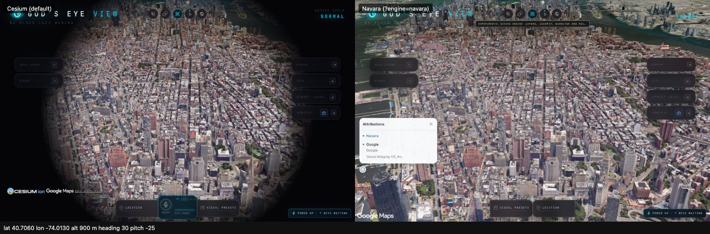
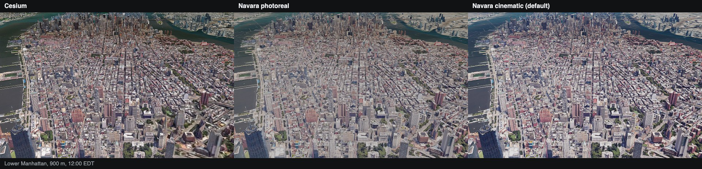
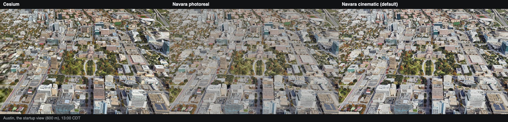
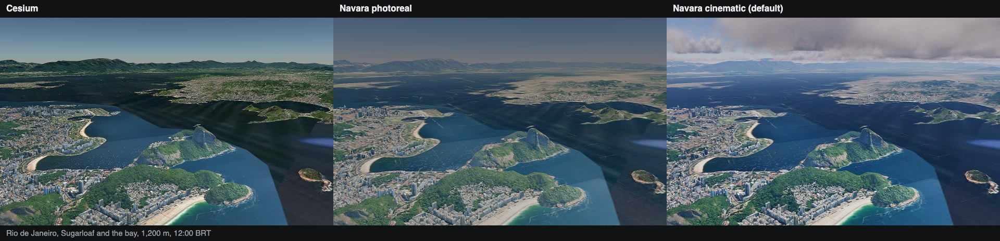
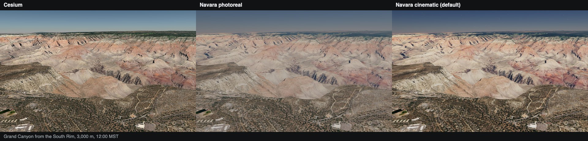
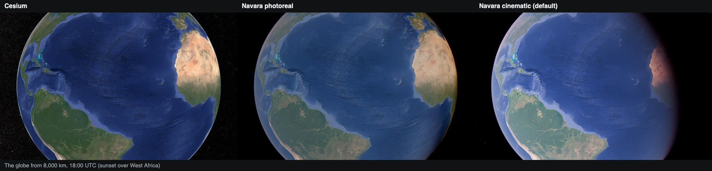
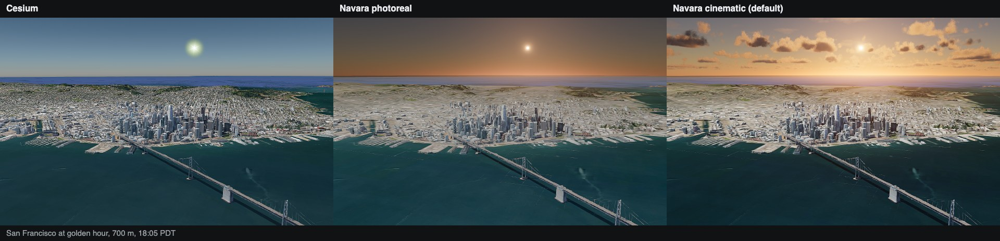
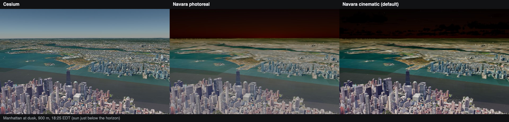
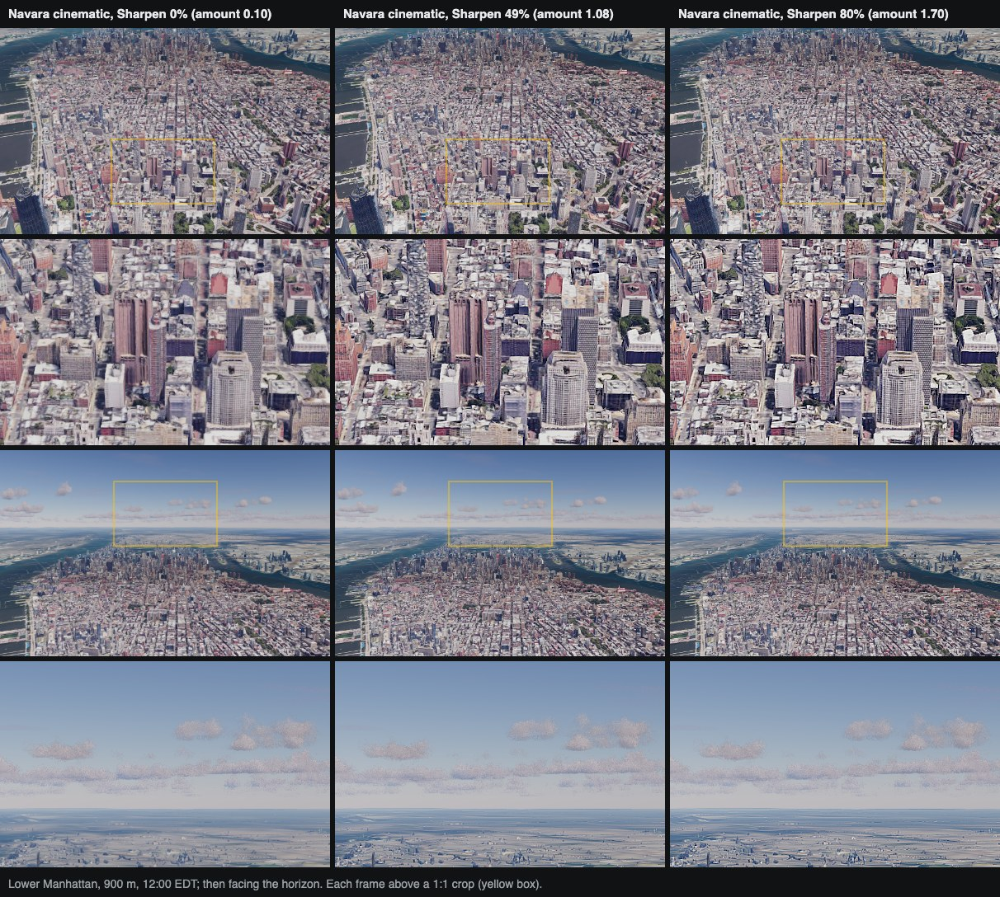

# Phase 2 report: the globe engine and gev on Navara

Phase 2 put gev's application shell on an engine interface and added a
second engine behind it. `src/globe/` holds the contract, a Cesium engine and
a Navara engine (`@navaramap/three` 0.2.1). The app boots on Navara with
`?engine=navara`, with the map, camera, search, HUD and share links working
and the layers off. Cesium stays the default, and Cesium mode behaves as
before. Branch `migration/phase2-engine`, base `6193d50c` (the end of phase
1a).

**Choosing the engine:** `?engine=navara` (or `?engine=cesium`) in the URL;
otherwise the localStorage key `gev.engine` (`navara` or `cesium`), read by
`src/app/engineChoice.js`; otherwise Cesium. The storage key is a hidden
opt-in: nothing in the app writes it, so it is set only by hand (for example
`localStorage.setItem('gev.engine', 'navara')` in the console). An unknown
value or unreadable storage never selects Navara.

This is the exit criterion of the roadmap's phase 2. Layers keep running on
the Cesium viewer until phase 1c moves them onto the engine.

## History

| Commits | Content |
|---|---|
| `b43f0091`, `3a1ed636`, `11bee98f` | the contract (`src/globe/contract.js`), its engine-neutral suite and a fake engine on `src/geo` (Task 1) |
| `b1cd74eb`, `f645aae6` | the Cesium engine, `src/globe/cesium/` (Task 2) |
| `a2a5f344` | the app constructs the engine beside the viewer (Task 3) |
| `283c592f` … `8c5bba5f` | overlays, pick, services, credits and map sources use the engine; map sources become engine-neutral descriptions (Task 4) |
| `b1d02790`, `95aae465`, `487f74b7`, `8a760d21` | Navara pinned, the Navara engine, hardening, and the members Task 4 added (Tasks 6–7, cherry-picked) |
| `e0c67478` … `17a11e2a` | camera, navigation, orientation, share links, HUD and director flights on the engine; render holds on Navara (Task 5) |
| `9395fdc4` … `3f097ea1` | `?engine=navara` in the app, the build, the ground floor, attributions and the shell QA (Task 8) |
| Task 9 commits | shell QA across engines, the timing bench and this report |

Every commit passes `npm test` and `npm run check:boundaries`, with one
exception: between `95aae465` and `487f74b7` the Navara shape test fails,
because the members Task 4 added arrive only in `8a760d21`.

## What works on Navara

Checked headless by `scripts/qa-engine-shell.mjs` on the dev server and on
`vite preview` of a production build (see QA below):

- **Boot:** the app starts on Navara with no Cesium viewer
  (`window.__godsEyeView.viewer === null`) and shows the persistent notice
  "Experimental Navara engine / Layers, cockpit, director and voice are
  unavailable".
- **Map stacks:** Google Photorealistic 3D Tiles (with a Google key) and Esri
  imagery, and switching between them; OSM imagery and keyless terrain under
  Google tiles pass in the contract QA. ion World Terrain is wired but was
  never exercised live. Bing
  is unavailable on Navara, with a reason in the picker.
- **Camera:** boot flight, search ("Paris", "Tokyo"), city pills and POIs,
  north up, tilt, wheel zoom with a ground floor 30 m above the sampled
  surface, orbit, reset to the globe.
- **HUD:** coordinates, MGRS, altitude and the rest follow the camera.
- **Share links:** a hash written on either engine restores the same pose on
  either engine.
- **Attributions:** Navara's attribution card shows the Google line on
  screen.
- **Rendering on demand:** with the tiles loaded and the camera still, Navara
  renders no frames, as Cesium does.
- **Lazy loading:** Cesium mode requests no Navara code or assets.

## What is off on Navara

- **Layers:** the layer catalog is empty and the layer controls are inert
  stand-ins (`absentLayerControlServices()`). They stay on the viewer until
  1c.
- **Pick:** `picker.pick` and `drillPick` return nothing. Navara picks its
  meshes only on click gestures (`featureClick`); that maps to picks carried
  on input payloads, deferred to 1c together with the layers.
- **Google 3D tiles without a browser key:** on Navara they need a browser
  `googleApiKey`. A deployment that serves Google through the server token
  (`/api/google/tiles-token`, Cesium's route) has none in the browser, so
  Navara falls back to Esri imagery there until the S3 proxy (next steps).
- **Visual styles and bloom:** no post-process stages, so the style
  buttons and Bloom change nothing. The notice does not mention them.
  Sharpen works (see "Sharpen on Navara").
- **Not constructed:** the cockpit, the director (so no data packs and no
  shot interactions), annotations and the draw tool, voice, the imagery box,
  scope mask, tracked-entity hold, embedded views, the first-run welcome
  (its choices turn on layers), CelestialRing, detection and the tracked
  readout.

## The contract

[`src/globe/contract.js`](../../src/globe/contract.js) defines
`GlobeEngine` in JSDoc, `createEngineEvent()` (the contract's own event
semantics), `assertGlobeEngine()` and `GLOBE_ENGINE_MEMBERS`. Positions are
`src/geo` values and angles are radians; pose angles follow Cesium's ranges.
The engine-neutral suite (`src/globe/testing/`) runs on the fake engine in
Node and on both real engines in `scripts/qa-globe-contract.mjs`.

The 60 required members:

| Capability | Members |
|---|---|
| — | `kind`, `destroy`, `isDestroyed` |
| `host` | `container`, `canvas`, `size` |
| `camera` | `pose`, `livePosition`, `height`, `setView`, `flyTo`, `flyToSphere`, `flightActive`, `lookAt`, `lookAtTransform`, `transform`, `release`, `cancelFlight`, `zoomIn`, `zoomOut`, `viewRectangle`, `pickEllipsoid`, `pickRay`, `changed`, `moveStart`, `moveEnd`, `commanded`, `percentageChanged` |
| `picker` | `pick`, `drillPick`, `pickPosition`, `pickPositionSupported`, `pickGlobe` |
| `projector` | `worldToWindow`, `viewProjection`, `horizonVisible` |
| `frames` | `preUpdate`, `preRender`, `postRender` |
| `render` | `request`, `setContinuous`, `isContinuous`, `setSharpen`, `sharpen` |
| `surface` | `sampleHeight`, `supported`, `terrainHeight`, `terrainHeightSupported`, `clampToHeight`, `clampToHeightSupported`, `tilesLoaded` |
| `input` | `on`, `setCameraInputs` |
| `credits` | `addStatic` |
| `maps` | `setBaseImagery`, `setTerrain`, `setPhotorealTiles`, `releasePhotorealTiles`, `photorealActive`, `current` |

Against the plan's contract, the tasks added `livePosition`, `height`,
`flightActive`, `lookAtTransform`/`transform`, `zoomIn`/`zoomOut`,
`commanded`, `pickGlobe`, `viewProjection`, `horizonVisible`,
`terrainHeight`, `clampToHeight`, `releasePhotorealTiles`, `current`,
`isDestroyed`, `pose().aspectRatio`, input modifiers, `render.request(reason)`
and `flyTo` options `endTransform` and rectangle destinations. Each came with
suite checks. The suite also checks that `pickPosition` and `worldToWindow`
round-trip within 1.5 px (over New York, straight down and tilted) and that
`maps.setTerrain` resolves for keyless terrain and rejects an unknown kind,
on the fake and on both engines.

Three members have no shell caller in Navara mode yet and are kept for 1c:
`camera.flightActive` and `input.setCameraInputs` (the cockpit's camera
input lock) and `maps.current` (diagnostics).

`maps.*` take engine-neutral source descriptions from `maps/registry.js`
(`kind`, URL, keys); only the Cesium engine also gets prebuilt Cesium
providers.

## Deviations and known gaps

- **Pick on Navara deferred** (above). The ruling: picks arrive on the
  input payloads in 1c.
- **Visual styles off on Navara** (above).
- **Attribution card is closable.** Navara's card has a close button. Once
  it is closed, the data-provider lines are gone and only the ⓘ toggle and
  the Google Maps logo remain. Before Navara can be the default, gev needs an
  always-visible Google copyright line (mirrored into the HUD credit strip).
- **Worker-pool leak on a fast destroy.** Disposing a Navara view within about
  1.5 s of `init()` leaks about 11 workers: the pool's warm-up ignores
  `terminated`. Upstream ask; a possible mitigation is to defer dispose by
  about 2 s after init.
- **Frames after orbit while tiles stream.** After orbit stops on Navara,
  `render.isContinuous()` is false but Navara keeps rendering, up to 60 fps,
  while tiles stream in; it goes to 0 once the view settles. The shell QA
  records the rate (0 in the final runs; up to 90 frames in 1.5 s in
  Task 8's runs).
- **`cameraSensitivity` keeps two ledger keys.** It accepts an engine, a
  viewer or a camera, and a Cesium camera and `engine.camera` are separate
  keys. All layers have to switch together in 1c.
- **`cullPosition` stays a `Cesium.Cartesian3`,** because a test checks
  `instanceof`; it moves in 1c.
- **Director and data packs off on Navara.** The director is never
  constructed there, so neither startup nor a share link reaches the data-pack
  or interaction paths.
- **Layer paths still on the viewer:** `scenePick`, `groundSnap`,
  `meshFloorSampler` and the OSM and dynamic credits keep their viewer
  branches until 1c moves their callers.
- **Navara private internals,** all in
  [`src/globe/navara/internals.js`](../../src/globe/navara/internals.js),
  pinned to 0.2.1 by a test:
  - `ModelMesh.prototype._releaseGeometryArrays`, patched to keep tile
    positions and indices on the CPU for `surface.sampleHeight`;
  - `view._scenes.mrt`, the loaded 3D-tile roots;
  - `view._isIdle`, for `surface.tilesLoaded()`.
- **Upstream asks for Navara:**
  - an option to retain tile geometry for ray queries, or a
    `sampleHeight`/ray query over 3D tiles;
  - a public `isIdle`/`tilesLoaded` getter;
  - a fix for the worker-pool warm-up after `terminated`;
  - terrain or tile collision in the camera controller (gev adds its own
    floor, `src/globe/navara/groundFloor.js`);
  - a synchronous pick, or picks with ids for 3D tiles.
  - (phase 3) the transparent pass copies the sun's cascaded shadow lights
    with `CascadedDirectionalLights.copy`, which clones every cascade each
    frame: new light ids grow three's light uniforms cache by about
    1.2 KB a frame (4.3 MB/min post-GC at 60 fps in the minimal and
    photoreal looks). gev patches the copy to update in place
    (`src/globe/navara/cascadedLightCopy.js`, applied by `internals.js`);
    upstream: copy cascaded lights in place;
  - (phase 3) a click pick that is not stale when clicks follow each
    other within a frame (0.2.1 answers with the first click's pick).
- **Other notes:**
  - Navara logs `THREE.WARNING: Multiple instances of Three.js being
    imported` (a warning, not an error).
  - ion World Terrain on Navara was never exercised live (no ion token in
    the test setup).
  - Navara hides the last raster layer instead of deleting it, to avoid a
    terrain bug when the layer count reaches 0.

## Bundle

| | `17a11e2a` (before Navara mode) | now |
|---|---|---|
| Main chunk (Cesium mode) | 2,844,121 B | 2,849,217 B (+5,096 B, +0.18 %) |
| Navara-mode app code (lazy) | — | 2,525 B |
| Navara engine chunk `navara-engine-*` (lazy) | — | 2,951,669 B |

The main chunk grew by about 5 KB for the mode branches only; no Navara or
three code is in it. `dist/` gains about 37 MB of Navara workers, wasm and
atmosphere assets, all loaded only on `?engine=navara`.

## Measurements

`scripts/qa-engine-bench.mjs`, headless Chrome with `--use-angle=metal
--disable-gpu-vsync --disable-frame-rate-limit`, 1280×800, on this Mac.
Each engine got one discarded warm-up run, then 3 runs, each in a fresh
browser context. Each cell is the median of that metric over the 3 runs
(per-metric medians, not the values of one median run).

- **Initial view:** navigation start to the startup pose (Austin, 600 m)
  with the camera still and the tiles loaded, both for 1.5 s; the time is
  when the later of the two began.
- **Flight:** the camera is set over Austin at 20 km looking down, the tiles
  load, then `flyTo` Paris at 20 km, 10 s, `cubicInOut`. Frame time is
  postRender to postRender over the flight.

| | Cesium dev | Navara dev | Cesium preview | Navara preview |
|---|---|---|---|---|
| Engine ready (ms) | 1,271 | 2,311 | 1,053 | 1,766 |
| Initial view (ms) | 8,322 | 12,816 | 8,109 | 12,411 |
| Flight frames per second | 57.6 | 201.1 | 55.4 | 206.2 |
| Frame time p50 (ms) | 21.0 | 3.9 | 21.4 | 3.7 |
| Frame time p95 (ms) | 23.6 | 10.1 | 24.3 | 10.0 |
| Longest frame (ms) | 38.9 | 267.3 | 30.6 | 360.2 |

Individual runs: initial view Cesium 8,316–8,522 (dev) and 8,009–8,409
(preview) ms; Navara 12,620–14,928 (dev) and 12,310–12,411 (preview) ms.
Navara's longest frame ranged 241–530 ms across all six runs.

Reading the numbers:

- **Headless numbers are indicative only:** no display, no vsync, one
  machine.
- **Startup:** Navara reaches the initial view 4.3 s (preview) to 4.5 s
  (dev) later than Cesium. Its engine is ready about 0.7–1 s later (the lazy
  chunk, wasm and workers); the rest is tile loading and refinement.
- **Flight:** the engines do different work. Cesium mode runs the default
  "normal" visual style's post-process stages, which Navara mode does not
  have. Cesium drew 55–59 frames per second while the browser ran 100–104
  animation frames per second, so Cesium drew roughly every other
  animation frame; the cause was not investigated. Navara drew one frame per
  animation frame, at about 200 per second.
- **Spikes:** Navara has single frames of 240–530 ms during the flight
  (Cesium's worst is 41 ms). They are likely tile-content uploads but were
  not profiled. Navara's 10 s flights also took 10.5–10.8 s of wall time
  against Cesium's 10.0 s.
- **Shell QA load times** (boot rest to tiles loaded): Cesium 1.3 s dev and
  1.0 s preview, Navara 4.1 s dev and 3.6 s preview.

## Screenshots

Both engines at `#lat=40.7060&lon=-74.0130&alt=900&heading=30&pitch=-25&roll=0`
(lower Manhattan), headless, once each engine reported its tiles loaded. The
framing is the same pixel for pixel: both cameras have a vertical field of
view of 39.683° at 1280×800 (60° across the wider side), and a
`pickPosition` → `worldToWindow` round trip lands within about 1 px on both
(the contract suite checks 1.5 px). The visible difference is Cesium mode's
default "normal" style, whose radial vignette darkens the corners on the
left; Navara (right) has no post-process stages. Navara also shows its
attribution card.

## Navara look

Navara mode now opens with a `cinematic` look. `?look=photoreal` gives
Navara's own photoreal scene (the previous default) and `?look=minimal`
gives the bench scene. The plan is the pure `navaraScenePlan` in
[`viewOptions.js`](../../src/globe/navara/viewOptions.js), and
[`look.js`](../../src/globe/navara/look.js) builds it and keeps it
current. Cesium mode is unchanged: its main chunk is byte-identical to the
one built from `6ebd3a63` once chunk hashes are masked, at 2,849,217 B.

**What the cinematic look adds to photoreal:**

- **Volumetric clouds** (`clouds`, quality `low`, coverage 0.2), lit by
  the real sun. They are the biggest visible gain: at golden hour they turn
  orange against the sky. Both cumulus layers start at 1,500 m instead of
  750 and 1,000 m, so at the city views (Austin's 600 m, Manhattan's
  900 m) they fill the sky without hiding streets. They are a procedural
  backdrop, not weather data, so they show only where they cannot get in
  the way:
  - they hide above 4 km (and show again below 3.5 km), where they would
    lie between the camera and the map;
  - they hide over ground above 1,000 m in view (and show again below
    800 m), where they would cut into the terrain as dark puffs (the Grand
    Canyon). The ground is the depth a quarter of the way up from the
    bottom of the last frame, read when the camera comes to rest and once
    more when the tiles have loaded. Each read stalls for 1.5 to 4 ms, so
    none run while the camera moves.

  Switching the clouds costs no shader compile. While they are hidden,
  `look.js` parks the last cloud image they handed the aerial perspective
  (otherwise it keeps compositing it as grey ghosts). They cast no shadows
  on the ground, because dark patches over the map read as features. They
  do not animate: an idle view still draws 0 frames.
- **ACES filmic tone mapping** in place of AgX. On Google tiles, AgX
  washes the baked colours out. ACES restores contrast and saturation (see
  Manhattan and Austin) without relighting the tiles.
- **A night side from space.** Above 1,500 km, with the camera at rest,
  the aerial perspective lights the globe from the atmosphere (`irradiance`
  with depth-reconstructed normals and `albedoScale` 2). The terminator,
  the dusk glow and the dark hemisphere become visible, while Cesium and
  photoreal show a fully sunlit Earth. The lighting switches back off below
  1,000 km, before the tiles would show relit.
- **A daylight sky.** Navara's sky, clouds and haze come from the
  atmosphere model in physical radiance, scaled for an exposure near 10.
  The Google tiles carry baked colours that need exposure 1. At exposure 1
  the noon sky came out dark navy: sRGB about (39, 58, 90) facing the
  horizon over Manhattan, with the stars showing through. Photoreal still
  shows a dull grey-blue (Rio). Raising `view.toneMappingExposure` does
  brighten the sky, but it washes the tiles out as well.

  The cinematic look instead multiplies the atmosphere's
  radiance-to-luminance factors by 3 (`ATMOSPHERE_LUMINANCE_SCALE`): the
  sun and sky factors of the sky, the aerial perspective and the clouds.
  The tiles are untouched. The noon sky now reads about (99, 127, 168), a
  daylight blue near Cesium's. The haze over distant ground brightens with
  it, and golden hour and dusk keep their colours.

  The factors are uniforms of the takram materials, reached through each
  handle's `ref.raw`. `forEachLuminanceUniform` in
  [`internals.js`](../../src/globe/navara/internals.js) holds the paths,
  under the pinned-version guard; if a built object loses its path, it
  throws in the dev server and warns once in a build. `look.js` sets each
  factor to 3 × the base value recorded the first time it is seen, and
  never multiplies in place. Navara shares one vector per factor between
  the sky, aerial perspective, clouds and stars, and a rebuilt material may
  copy an already scaled vector; neither can scale anything twice. The
  stars keep the base value: when they share the sky's vector, they get
  their own.
- **Stars only at night or from space** (intensity 120, 2 px; the
  default is 10 and 1 px). They show above 100 km, or once the sun at the
  camera is below −6°. They hide below 80 km once the sun is above −4°
  (`starsVisibleAt`). By day they no longer dot the sky. From 8,000 km a
  sparse starfield shows beside a sunlit Earth. At intensity 40 it was
  almost invisible in the gallery's half-size tiles.
- **Clouds only while the sun is up at the camera.** They hide below 0°
  and show again above 2° (`cloudsSunlitAt`). Unlit after sunset, they
  read as dark puffs over the dusk sky (Manhattan at dusk).
- **No sun shadow maps** (`castShadow: false`). The tiles carry baked
  light, so the maps would darken nothing.
- **Lens flare and SMAA**, as in photoreal. A mobile-optimized view drops
  the clouds and the lens flare and uses FXAA.

**The sun follows the wall clock.** The HUD's SUN elevation uses
`new Date()`. Navara's atmosphere took its date once, when the module
loaded, and never moved, so it drifted from the HUD over a long session.
On every frame Navara draws anyway, `look.js` now resets the atmosphere's
date once it is more than a minute off. An idle view stays idle.

**What was tried and rejected, judged on Google photoreal tiles:**

- **Deferred lighting up close** (`deferredLighting`, `shadow`,
  `specular`). The tiles' light is baked, so relighting them double-shades
  them: Manhattan turns grey and dark, and the sun's shadows and specular
  add nothing visible on top of the baked shadows. It is used only from
  space, where the imagery is flat.
- **SSAO.** It greys facades and darkens the baked ambient occlusion a
  second time.
- **SSR.** It reads the G-buffer normals, which are zero for Google tiles
  (see the limits below), and the tiles mark no water, so it has nothing
  to reflect from. Not measured further.
- **Depth of field and rain drops.** They hurt legibility and are
  gimmicks for a map.
- **Colour grading LUT.** Its default LUT is fetched from
  raw.githubusercontent.com (an outside host, blocked by gev's sources
  policy), and ACES already does the grading.
- **Fog light.** It only matters with point lights, and gev has none.
- **Exposure.** `view.toneMappingExposure` does reach the tone-mapping
  pass (exposure 4 turns the noon sky blue), contrary to an earlier note
  here, but it scales the baked tiles too and washes them out. The
  atmosphere scale above brightens only what the atmosphere draws.

**Gallery** (`node scripts/qa-navara-look.mjs`, headless Chrome with
`--use-angle=metal`, 1280×800, each engine's own canvas). Each row shows
Cesium, Navara photoreal and Navara cinematic at the same pose and the same
sun (the page clock is shifted to the scene's time):

**Cost.** Measured with `qa-engine-bench.mjs --server=preview` (flags as
under Measurements: Austin to Paris at 20 km, 10 s): 3 runs per look, after
a 90 s cool-down each, per-metric medians:

| Navara look | Flight p50 (ms) | Flight p95 (ms) | p95 per run (ms) | Longest frame (ms) | Frames per second |
|---|---|---|---|---|---|
| photoreal | 6.9 | 12.1 | 11.9–12.6 | 400.5 | 143.3 |
| cinematic | 6.8 | 12.3 | 12.0–12.4 | 304.7 | 147.2 |

- **The flight:** it runs at 20 km and above, where the clouds are hidden,
  so cinematic costs what photoreal costs. Both meet the 16.7 ms p95.
- **An earlier series** on a busier machine measured both looks about
  2 ms higher at p95 (photoreal 14.0, cinematic 14.2).
- **Clouds shown:** before the clouds hid above 4 km, the same flight
  measured cinematic at p50 11.1 ms and p95 17.8 ms (16.1–18.2 ms over two
  series), over the budget. Hiding them from above is a legibility rule
  that also keeps flights within the budget.
- **Clouds where they show:** at a still view over Austin, 3 km up and
  looking at the horizon, they add about 3.3 ms per frame (p50 11.2 against
  7.9 ms without them, dev server). At the startup view (600 m) they add
  about 1.2 ms. Quality `low` saves about 1 ms against `medium`. Neither
  the cloud resolution scale nor cloud haze, light shafts or shadows
  changed the cost measurably.
- **The rest of the look costs nothing measurable:** without clouds,
  cinematic and photoreal both show p50 7.9–8.2 ms at that view.
- **Noise:** these are headless numbers on a shared machine. Back-to-back
  runs without a cool-down drifted by up to 6 ms, so compare only runs
  taken under the same conditions.

**Idle and QA:** with the tiles loaded, Navara draws 0 frames after 2 s
(`qa-engine-shell`), at the startup view and at rest at 8,000 km with the
globe lit. The shell's pixel checks ("map is drawn") pass unchanged under
the new look.

**Known limits of the look:**

- **The tiles keep their daylight at dusk and at night.** The sky darkens
  but the city stays lit (Manhattan at dusk). Relighting them is the
  rejected deferred lighting.
- **Switching the night side rebuilds the aerial-perspective shader.** An
  earlier headless series measured a 0.6–0.8 s frame for a cold switch.
  The look now compiles both variants on its first two frames, during
  startup.

  On a 6 s flight from 8,000 km to Manhattan, measured on the contract
  page with 3 runs each:
  - the frame that switches the night side off at 984 km took 42–43 ms
    before the warm-up and 28–33 ms after;
  - the longest frame of the flight was 84–200 ms before and 96–99 ms
    after, both near the ground as tiles load.

  The switch on, at rest at 8,000 km, measured 41–48 ms either way on this
  machine, so the 0.6–0.8 s stall did not reproduce cold here. The switch
  still happens only at rest, so a flight from city to city through space
  (the bench flight peaks at 2,300 km) never switches.
- **The clouds are procedural,** not weather data. They are a backdrop,
  not a forecast. At low quality they show a fine grain in still frames.
  Between two rests they keep the last ground decision, so a low flight
  from the coast into the mountains hides them only once it stops.
- **`surface.sampleHeight` under the camera (fixed).** At the Austin
  startup view it returned `undefined`, on both looks, for the ground
  under the camera. The geometry-retaining patch was fine: 699 of 699 tile
  meshes kept their positions. At 600 m, looking 30° down, the ground under
  the camera lies outside the frustum, and Navara hides (`visible = false`)
  the tiles outside the frustum and the parents it refines. The ray only
  tried shown tiles, so it missed.

  When the shown tiles miss, the ray now tries the loaded hidden tiles. It
  collects them only after that miss and allocates nothing per node on the
  shown path. It takes the hit on the finest tiles: an extent within 1.5×
  the finest tile hit, since a quadtree parent is about twice its child.
  Navara 0.2.1 exposes no geometric error or level on a tile, so a tile's
  extent (the bounding sphere around all its meshes, computed once) is the
  level measure. Per-mesh radius would let a small mesh of a coarse tile
  win. Taking the top hit would pick a coarse parent instead: 143.2 m
  against 121.9 m under the camera. Against Cesium at seven points from
  under the camera to the view centre, the deltas are 0.13–1.04 m
  (`qa-engine-shell`, tolerance 2 m). The cloud rule still reads depth,
  which is the ground in view rather than under the camera.
- **Navara's G-buffer normals are zero for Google tiles and the globe,**
  which turns atmosphere lighting black. The look reconstructs normals
  from depth (`useNormalBuffer: false`).

**Upstream asks for Navara:**

- G-buffer normals for 3D tiles;
- a sky luminance or atmosphere exposure that leaves unlit content (the
  baked tiles) alone, in place of the uniform scale;
- a way to switch `irradiance` without recompiling, or a precompile
  option;
- a sun date that can follow the clock.

## Sharpen on Navara

The Sharpen toggle and slider now work in Navara mode, and Navara opens
with Sharpen on at 80 % (Cesium keeps 49 %).

**The contract.** `render.setSharpen({ enabled, amount })` and
`render.sharpen()` (60 members). `amount` is the Cesium stage's uniform,
which the slider maps from 0–100 % to 0.1–2.1 (`sharpenAmount` in
`visualPresets.js`, shared by both engines). Omitted fields keep their
value, and bad values throw a `TypeError`. The Cesium engine only keeps
the state: Cesium mode still sharpens with its own post stage, unchanged,
and `VisualEffects` mirrors that stage's state into
`engine.render.setSharpen`, so `render.sharpen()` reports what Cesium
draws.
The fake engine records the calls. The contract suite checks merging, the
copy `sharpen()` returns, rejection and a drawn frame on all three engines.

**On Navara** ([`sharpen.js`](../../src/globe/navara/sharpen.js)) the
sharpening is a custom `EffectDesc`, using public API only:

- **The maths:** Cesium's unsharp mask, `center + (center − blur) × amount`
  over a 3×3 box blur, clamped to [0, 1]. Cesium sharpens gamma-encoded
  colours (its tone mapping ends in `czm_inverseGamma`), while Navara's
  buffers stay linear until the final copy. The mask therefore encodes
  with gamma 2.2 and decodes afterwards, so one amount sharpens the same
  on both engines.
- **Where it sits:** directly after `toneMapping`, before `smaa` (or
  `fxaa` on mobile, or `final` in the minimal look). Navara's pass list
  in the cinematic look reads `skyEnvMap`, `mrt`, `aerialPerspective`,
  `clouds`, `lensFlare`, `transparent`, `toneMapping`, **`gevSharpen`**,
  `smaa`, `final`. This is Cesium's order too: its custom
  stages run after tone mapping and before FXAA. After tone mapping the
  colours are in display range, so highlights do not blow up, and SMAA
  then smooths the stair steps that sharpening brings out.
  `qa-globe-contract` checks this order in Navara's pass list.
- **The sky is left alone.** Navara's clouds are dithered at the `low`
  quality the look uses, and at 80 % the mask turned their grain into
  visible noise. A pixel whose scene depth (the MRT pass's packed depth
  buffer, the one the S1 drape reads) is past 0.99999, the far plane less
  the RGBA8 packing's rounding, keeps its colour.
  Facing the horizon, the top of the frame changes no more with the mask
  at amount 2.1 than between two frames without it (`qa-globe-contract`).
- **Its own pass.** A convolution reads its pass's input, so merged into
  the tone-mapping pass it would blur colours that are not tone mapped
  yet, and Navara 0.2.1 has no public way to merge passes anyway. The
  pass is added the first time Sharpen is on. While Sharpen is off it is
  disabled, which costs nothing.

**The app.** Without a viewer, `VisualEffects` sends the slider and the
toggle to `engine.render.setSharpen`. The defaults depend on the engine:
the baseline (`GLOBAL_POST_DEFAULTS`) and every style preset set sharpen
to `ENGINE_SHARPEN_DEFAULT`. `presetSharpenIntensity` resolves that to
`SHARPEN_INTENSITY_DEFAULTS[engine]`, which is 49 on Cesium and 80 on
Navara. Explicit values are never remapped. What that means in Navara
mode:

- **First load:** the slider shows 80 % with Sharpen on.
- **Switching style** (Normal, CRT, NVG, FLIR...): Sharpen goes back to on
  at 80 %, as on Cesium it goes back to 49 %. Any change made by hand is
  replaced, as on Cesium.
- **Share links** carry an explicit `si` and restore it unchanged: a
  Navara link restores 80, and a Cesium link with `si=49` opens at 49 on
  Navara too. A link without `si` falls back to 49, the link parser's
  fallback (`sharelink.js`, left as it is for Cesium).
- **Explicit calls** (`styleManager.setSharpen`, the voice action) set
  exactly what they ask for.
- **Scene shots:** the director is not built in Navara mode, so none apply.

**Look** (`node scripts/qa-navara-look.mjs --sharpen=0,49,80`, headless
`--use-angle=metal`, 1280×800, the slider set through the shell): Lower
Manhattan at 900 m, then the same place facing the horizon. Each frame is
shown above a 1:1 crop.

- **The city:** at 80 % facades, windows and street edges come out
  clearly, with thin halos along high-contrast edges (dark roofs against
  light walls). Far ground near the horizon gets crisper and busier.
  49 % is the gentler choice.
- **Sky and clouds:** unchanged at every level (the depth mask). Without
  the mask, 80 % visibly amplified the cloud grain.

**Cost.** Measured with `qa-engine-bench.mjs --engine=navara
--server=preview --runs=3` (the flight from Austin to Paris at 20 km, 10 s,
1280×800). Sharpen was on at 80 % (the default), then off with
`--navara-sharpen=off`, then on again, with a 90 s cool-down between
series:

| Navara, cinematic | Flight p50 (ms) | p50 per run | Flight p95 (ms) | p95 per run | Frames per second |
|---|---|---|---|---|---|
| Sharpen on, 80 % | 8.0 | 7.9–8.0 | 14.2 | 13.1–14.7 | 128.3 |
| Sharpen off | 7.1 | 7.0–7.2 | 12.5 | 12.4–12.8 | 142.3 |
| Sharpen on, 80 % (again) | 7.7 | 7.7–8.0 | 14.0 | 13.9–14.0 | 132.3 |

- **The cost:** about 0.6–0.9 ms at p50 and 1.5–1.7 ms at p95. That is the
  ~0.8 ms fixed cost of a separate Navara pass (S1) plus nine
  gamma-encoded reads per ground pixel. The flight stays within the
  16.7 ms p95 budget, with less margin than before (14.0–14.2 ms against
  12.5 ms).
- **Sky pixels** cost one depth read and no blur.
- **Cheaper options**, if the margin is needed back: merge the mask into
  another pass (an upstream ask since S1), or drop the gamma round trip
  and sharpen in linear space. The second would make the same `amount`
  look a little different from Cesium.

## QA

Final runs at the last commit, headless on free ports (never 4185):

| Check | Result |
|---|---|
| `npm test` | 6801 tests: 6800 pass, 0 fail, 1 skip (the Node 24 allocation budgets) |
| `npm run check:boundaries`, `npm run format:check` (1,412 files, every new phase 2 file included), `npm run build` | clean |
| `qa-globe-contract --engine=cesium` | 63/63 (56 contract, 7 engine) |
| `qa-globe-contract --engine=navara` | 66/66 (56 contract, 10 engine) |
| `qa-engine-shell`, dev server | Cesium 22/22, Navara 24/24, cross-engine 3/3 |
| `qa-engine-shell`, `vite preview` | Cesium 22/22, Navara 24/24, cross-engine 3/3 |

After the Navara look (see that section):

- `npm test`: 6814 tests, 6813 pass, 1 skip;
- `check:boundaries`, `format:check` (1,413 files) and `build`: clean;
- `qa-globe-contract --engine=navara`: 66/66;
- `qa-engine-shell --engine=both` on the dev server: Cesium 22/22, Navara
  24/24, cross-engine 3/3.

The Cesium contract run and the shell run on `vite preview` were not
repeated.

After Sharpen on Navara (see that section):

- `npm test`: 6822 tests, 6821 pass, 1 skip;
- `check:boundaries`, `format:check` and `build`: clean. The Cesium main
  chunk grew by 324 B (2,849,820 to 2,850,144 B, against a build of
  `17e4dfd5`): the contract members and the slider's routing. It carries
  no Navara, three or postprocessing code; the mask is in the
  `navara-engine` chunk;
- `qa-globe-contract`: Cesium 64/64 (57 contract, 7 engine), Navara 68/68
  (57 contract, 11 engine). The Navara run logged HTTP 429 from OSM's
  tile server after several back-to-back runs;
- `qa-engine-shell --engine=both` on the dev server: Cesium 22/22, Navara
  24/24, cross-engine 3/3. One earlier run timed out booting Navara
  (180 s); the rerun passed.

After the fix round (daylight sky, engine sharpen defaults, surface
heights under the camera):

- `npm test`: 6833 tests, 6832 pass, 1 skip;
- `check:boundaries`, `format:check` (1,417 files) and `build`: clean. The
  Cesium main chunk is 2,850,229 B, 85 B more than the Sharpen commit,
  for the engine-default presets;
- `qa-globe-contract`: Cesium 64/64, Navara 69/69. The new Navara check
  pins the look's clock to noon and to midnight at Manhattan, facing the
  horizon. At noon the top of the frame must be daylight blue (mean
  luminance ≥ 95, blue ≥ 140 and ≥ red + 30) with no star pixels (a pixel
  25 brighter than every pixel two away). At midnight it must show at
  least 5 star pixels, which also proves the detector works;
- the QA pages load OSM imagery and the keyless terrain through a shared
  disk cache with backoff on 429 ([`scripts/qa/tileCache.mjs`](../../scripts/qa/tileCache.mjs)).
  On a miss, at most two fetches run at once and identical misses in
  flight share one. The user agent names the repository as the contact.
  Only those two hosts are paused, through CDP `Fetch`: page-wide request
  interception also held the Navara workers' requests and failed the
  create → destroy → create check. Repeated runs now fetch only missing
  tiles. The last Navara run served 1,402 tiles from the cache, fetched
  260, and logged no 429;
- `qa-engine-shell --engine=both` on the dev server: Cesium 23/23, Navara
  25/25, cross-engine 4/4. The new checks:
  - `surface.sampleHeight` at seven points of the Austin startup pose,
    including the ground under the camera, is finite on both engines and
    agrees within 0.12–1.04 m (tolerance 2 m);
  - the wheel-zoom check now measures Navara's clearance against the
    floor's own ground (`engine.groundFloor`, a Navara-only diagnostic),
    with a threshold of 29 m. The floor keeps 30 m, and 1 m allows for
    the camera moving within a frame. Against a fresh sample, the tiles
    streaming in under a still camera moved the ground by about 8 m (79
    to 88 m over Paris) and made the check flaky. Cesium keeps
    `sampleHeight` ≥ −1 m.

  Each sample under the camera costs about 1.6 ms when the ground is
  outside the view (0.6 ms in view). The floor samples below 20 km while
  the camera is free: after 250 ms, or after a 20 m move once 100 ms have
  passed (`MIN_RESAMPLE_MS`), so a pan does not sample every frame.

After the review fixes (Cesium sharpen mirror, night-side warm-up,
internals and base-value scaling, allocation-free look frames, lazy
hidden tiles by tile extent, floor resample interval, sky mask margin,
polite tile cache, floor-ground wheel check, clouds after sunset,
brighter stars):

- `npm test`: 6840 tests, 6839 pass, 1 skip;
- `check:boundaries`, `format:check` (1,416 files) and `build`: clean. The
  Cesium main chunk is 2,850,287 B;
- `qa-globe-contract`: Cesium 64/64, Navara 69/69 (1,770 tiles from the
  cache, 25 fetched, no 429). One run failed the lifecycle check with
  "Execution context was destroyed": the dev server reloaded the page
  because a source file was edited during the run. The rerun passed;
- `qa-engine-shell --engine=both`: Cesium 23/23, Navara 25/25,
  cross-engine 4/4. Navara's wheel floor held 30 m over its own ground on
  every frame (threshold 29 m).

What `qa-engine-shell` measured, on dev (preview gave the same verdicts):

| Check | Cesium | Navara |
|---|---|---|
| Idle for 2 s after tiles load | 0 frames | 0 frames |
| Google line on screen | credit strip, Google Maps logo | attribution card, "Google" line inside the scrolled list |
| Search "Tokyo", HUD text parsed | 35°42'36.02"N 139°44'06.00"E, 8.5 km from the reference point | 35°42'36.00"N 139°44'06.00"E, 8.5 km |
| Wheel zoom floor over Paris (smallest clearance over the sampled surface on any frame) | 1 m (threshold ≥ −1 m) | 28.4 m dev, 29 m preview (threshold ≥ 25 m) |
| Share link reload on the same engine | Δ ≤ 1.4e-14° and 6e-9 m | Δ ≤ 7.1e-15° and 8e-9 m |
| Frames after orbit stops, over 1.5 s | 0 | 0 |
| Navara requests | 0 | 27 dev, 5 preview |
| Console errors | 0 | 0 |

Across engines:

- The Paris hash written on Cesium, opened on Navara, gives the pose that
  hash gave on Cesium, and the reverse: 0 m and 0° apart (tolerance 1 m and
  0.1°, heading and roll compared across the 0/360 seam). Both engines place
  the camera from the hash's rounded numbers, so they land identically.
- The side-by-side pose is also identical on both engines (0 m, 0°).

The "frames after orbit" gap above did not show in these runs (0 frames on
both servers); earlier runs recorded up to 90 frames in 1.5 s while tiles
streamed.

## Next steps

1. **Phase 1c: layers on the engine.** Move each layer family off the viewer
   onto the contract (picks on input payloads for Navara, render primitives
   through an engine-side layer host), then turn layers on in Navara mode.
2. **Google proxy (spike S3).** A same-origin `/api/google/tiles/*` proxy
   next to `/api/google/tiles-token`:
   - it rewrites `uri`/`url` in the tileset JSON, keeping `session`;
   - it authenticates upstream with `X-Goog-Api-Key` or a Bearer token from
     the existing token source (the spike tested only the header key);
   - it strips `key=` and fails closed with 502 if a key would still reach a
     response;
   - the CSP is unchanged (same origin), and it closes the browser-key gap
     above.

   Production also needs rate limits and per-user quotas, traffic
   accounting (about 1.8k upstream requests per 80 s city tour; 1,839 in the
   spike), a glb cache that honours Google's `Cache-Control`, streamed bodies
   and an origin check. Google's licence terms (attribution, caching only as
   the headers allow) stay with the app.
3. **Drape S1 in the product.** A drape post-effect with tiles, terrain and
   both modes, like Cesium's `ClassificationType`:
   - a height window of terrain −50 m to +600 m;
   - aircraft masked through G-buffer depth, which depends on the
     undocumented `raw.gbufferRenderTarget.depthTexture`, and gev's meshes
     must be `MeshDesc`;
   - about 0.8–0.95 ms p50 as its own `EffectPass` (an empty `EffectPass`
     alone costs about 0.8 ms) against 0.10 ms merged into tone mapping for
     a route and a block; the 256-segment stress case costs about 1 ms more
     even when merged;
   - real data needs a larger data texture and a grid for polygon edges
     (limits today: 256 segments, 8 polygons × 64 edges).

   Upstream asks (a drafted, unfiled issue): a native `clampToGround`
   drape for polylines and polygons (terrain, tiles or both), mergeable
   effects, and `effectIds` on tilesets without a batch table.
4. **Tile heights in `surface`.** Replace the retained-geometry patch with a
   public Navara height query over 3D tiles (the upstream ask above).
5. **An always-visible Google line** before Navara can be the default.
6. **A Dioxus UI, later,** once the shell no longer depends on Cesium.
