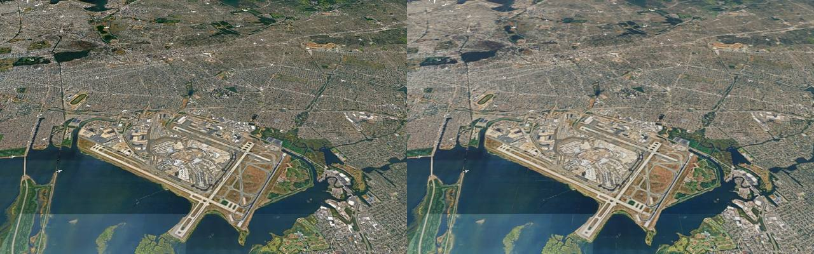
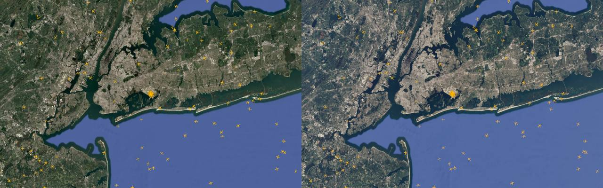
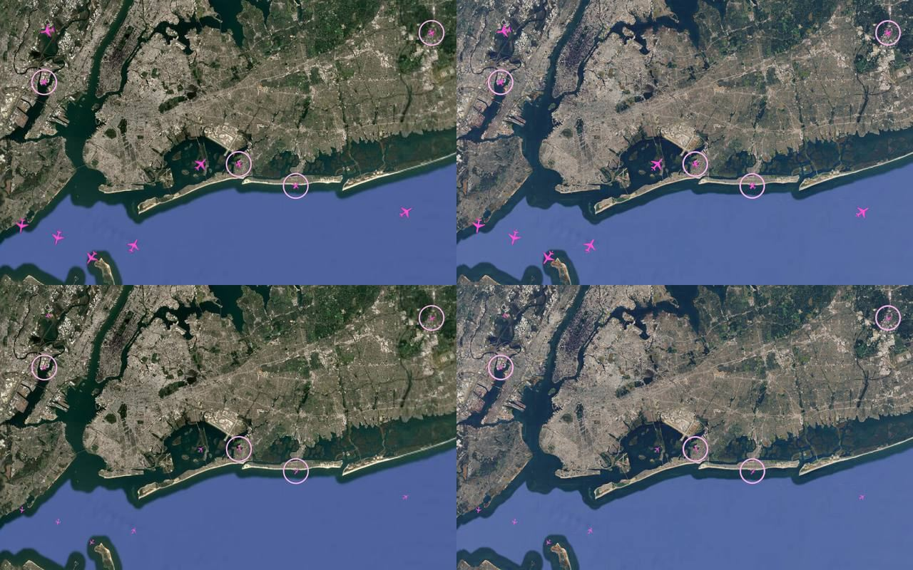
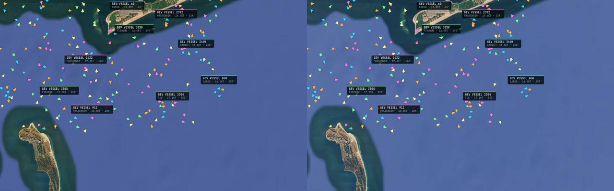
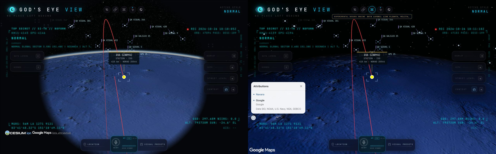
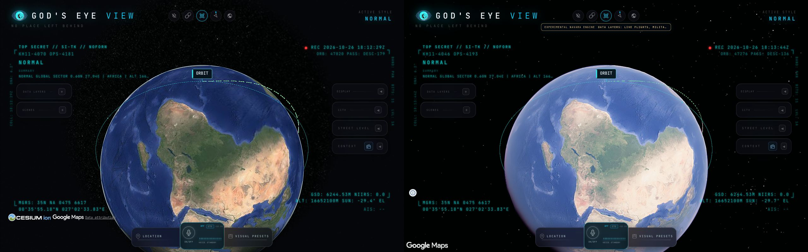

# Phase 3 — W1 acceptance (T16)

Dates: 2026-10-23–26. Branch: `migration/phase3-layers`, based on phase 2 `37f94164`.
**T16 complete with the inherited limits documented below.** All 37 W1 acceptance steps, preview pixel gates, both engine contracts, both shell runs and the four mandatory performance series pass. The 18 Cesium baseline PNGs are byte-identical. The legacy height-datum result retains five pre-existing W2 CCTV failures; live ADS-B/AIS availability is not established.

Local work only; no upstream requests sent, no push or publication. Machine-readable verdicts, measurement details, failure history and content hashes: [W1 evidence](phase3-w1-evidence.json).

## Scope and review

W1 consists of exactly six Navara catalog entries: `flights`, `military`, `local-adsb`, `ais-live-vessels`, `satellites`, `rocket-launches`. CelestialRing is included with satellites. W2–W4 and phases 4–6 are separate work.

Review covers the branch diff from `37f94164`, including the clock, movers/lines, input/selection, camera/follow, tile heights, overlay host, voice, catalog and all six renderers. Earlier extraction reviews and their evidence are retained in the SDD journal; this report does not reinterpret old failures as successful runs.

T16 findings:

- Six shared data modules still imported Cesium directly, outside the advertised boundary rule. Native projection/occlusion, trail implementations and SDK constants now live in `src/data/render/cesium*.js`; the public exports and native trail rendering are preserved. The checker covers all W1 shared modules, with six negative regression cases and updated package ownership.
- The W1 launcher lacked `--engine=both` and satellite/mission scenarios. It now invokes the existing acceptance suites sequentially and fails if a required layer is absent. Individual results are saved in JSON.
- The old global-view exception hid projection differences above 2 px. It has been removed after T15's surface-ENU camera fix. Current aircraft comparisons use the same 2 px threshold at every pose.
- Aircraft query comparison could skip different contacts chosen by real clicks. Query/share probes now use one fixed known fixture contact on both engines; mouse selection remains a separate real-input check.
- The strengthened fixed-target share probe initially used a transient `programmatic` follow and incorrectly expected that target to become durable. Existing share policy intentionally accepts only `user`/`voice`/`tool` intent. The probe now selects the fixed contact with `origin: user`, preserving real mouse-selection checks; the failed attempt is retained. No application behavior changed for this correction.
- The original fleet benchmark enabled only one layer. T16 measures civil and military together and asserts their populations. Its 10000 civil +1000 military source records contain 25 shared ids, intentionally suppressed from the civil layer: **9975 +1000 rendered contacts**, not 11000 unique contacts.
- Production deliberately excludes QA sources and the probe. `scripts/vite-w1-qa.config.mjs` makes a separate instrumented build in ignored `qa-artifacts/w1-preview/`, exposes only an explicit list of bundled QA module entry points through local canonical-module re-exports, and retains the same production renderer code. The normal build and normal preview are checked independently. Never deploy the QA output.
- A full QA-preview layer run exposed the same absent `/api/setup/status`404 already documented by the ordinary-preview shell harness. A diagnostic captured its exact response path and console location. `--preview` now records only that same-origin endpoint's resource404 separately; dev/default mode, different paths/origins/statuses, missing locations and runtime errors remain failures. Negative tests guard the exception. The original failed preview run remains retained; no app/API response was mocked and no renderer code changed.
- The complete preview satellite run found a real test-environment defect: redirecting `/src/time/clock.js` to its built asset instantiated two clock modules. A before/after headless probe proved this on both engines: QA's clock froze while `engine.clock.now()` still advanced. The preview now serves a tiny `export * from` shim targeting the canonical asset URL, preserving the application's module singleton. Satellite/launch suites assert clock identity before their scenarios. During that QA-only correction, production/QA JavaScript assets and application JS were unchanged. Benchmarks import only pure geo/fixture helpers, never this clock module. The later renderer/model-display corrections described below have fresh builds and all 30 measurement contexts were repeated. All preview scenarios are repeated after the correction, with the failed evidence retained.
- The final16 preview military run stopped on an unlocated HTTP500 in Cesium 24/25 (Navara 26/26); the exact original resource is unknown. Adding origin/path-only HTTP evidence exposed a second QA defect: its formally passing repeat still had a late `/api/vessels`503 after the console check. Native Cockpit had been invoked as an unasserted INFO probe; it establishes Contacts, including AIS and W2 layers absent from this single-layer fixture. The W1 probe now checks the intended Navara capability refusal and leaves Native Cockpit entry to its separate suites. All console/runtime verdicts execute after browser teardown; cross-comparison rejects both failed checks and recorded late errors. Three real CLI regressions cover late-error rejection, failed-check rejection and a clean control. All twelve dev/QA-preview suites and twelve comparisons are repeated; previous weak verdicts remain archived. No HTTP500/503 exception or app/build change is introduced.
- A Navara launch preview reported 120 disabled frames in 2 s despite no holds and continuous=false. The old harness assumed a five-second delay meant settled, without recording camera/tile readiness. It now records and bounds the same still-camera/loaded-tiles precondition as the shell, then still requires exactly 0 frames in 2 s. The original failure is retained; its exact cause is not inferred. The new standalone Navara preview diagnostic passes 31/31: camera delta0m, readiness stable after 1762 ms, loaded before/after the strict 2 s sample, exactly 0 frames and no runtime errors. The full W1 cycle is repeated with this precondition.

- The first strict preview comparison found military city counts 42/41. Full pose/object diagnostics reproduced SENTRY94 at x=1278.776/1280.365 with identical cameras, but sequential live dead reckoning differed by up to 145 m (3.03 px). Geometry now freezes the fixture and app clocks at 1792152005000, stores each pose's detached object/camera/time snapshots, and chooses five visible controls per pose. The clock is reset and the layer refreshed before the moving real-input/follow/voice scenarios. Comparison rejects absent or unequal geometry clocks; two additional real CLI regressions cover that boundary. Earlier unfrozen verdicts remain explicitly invalidated in the history rather than erased.
- The clock correction selected a different moving aircraft and exposed another QA oracle error: minimum follow range used an unfloored query position; the focus distance is also published before that frame's follow-camera step. The gate now reads the public settled follow/display cache and the camera together, retaining both earlier distances as telemetry. The original149m lower limit and real wheel input remain. An initial scope-variable error in the harness correction was caught by the browser run and fixed before acceptance.

- A final observer audit found that share-link pages checked restoration but did not attach console/runtime handlers. One strict W1 observer now aggregates main-page and share-page console errors, runtime exceptions and renderer crashes, keeping only page/status/origin/path for response diagnostics. The exact preview setup404 exception is unchanged. Three regressions cover shared-page error aggregation, exception scope and query-credential removal. The acceptance records include observed page names; all 24 engine/mode layer runs and twelve comparisons are repeated, with 64 application pages observed. Original weak observer verdicts remain explicitly invalidated in the ledger; independent pixels/contracts/shell/baseline and measurements are retained.

- Legacy W1 harnesses accept `QA_ANGLE=metal`; their previous defaults and old formatting remain intact. A full contract suite runs in one browser RPC, so its transport timeout must exceed the sum of individual checks; individual frame and semantic limits are unchanged.

Additional T16 review fixes:

- Model sets freed geometry/materials but not the textures shared by their material clones. Destruction now releases each owned texture once, including assets arriving after deletion; registry teardown also closes a pending descriptor load. Three regressions cover shared textures, late completion and rejected loads. A failed asset keeps the glyph fallback and emits a generic warning without its URL.
- The Navara follow drag capped the horizontal ratio after the opposite sign from native Cesium `rotate3D`. A single +640 px event produced +63.72° instead of −41.4° (the latter is the normalized +318.6° turn). The sign is corrected. Fresh-browser ±640 px cases now match: −41.4° /−63.72°, worst difference below 3e-11 degrees. `qa-follow-gestures.mjs` disables native spin inertia only to isolate this one input step; the normal gesture checks remain in the contract. The previous unit expectation encoded the incorrect cap and was replaced with the installed Cesium formula plus the opposite direction.
- The first combined benchmark exposed two unhandled `AbortError: Flights update aborted` messages: military-off starts a fire-and-forget civil refresh, and the subsequent flights-off cancels it. That refresh now owns its expected cancellation. Unexpected failures are still reported; QA does not filter these errors. Both regression cases fail on the old code and pass with the fix. The failed performance attempt remains `qa-artifacts/t16/fleet-abort-failed.json`.
- Joint fleet CPU profiles and review found repeated equal aircraft style writes and empty retained model banks still participating in three's material work. Sprite setters now reuse copied field records and skip unchanged styles; mutable position/color writes remain supported. Empty model meshes are hidden until repopulated, retaining their cached transforms/assets. Three regressions cover these invariants. The full original global→city→orbit sequence now passes; the failed earlier sequence remains recorded below.
- The plan audit caught viewer-only heading/focus/floor-hold/height-datum harness paths. Heading uses copied renderer matrices and the tracked glyph's cached rotation through the probe; reading the probe never evaluates its reactive native callback; its existing scenarios/assertions remain. Focus uses public camera/frame/canvas ports on Navara and retains the original evidence clock/scenarios. Floor-hold uses probe glyph positions and public tile sampling. Height-datum keeps the aircraft group on both engines and explicitly skips CCTV/native terrain-provider groups absent from the Navara W1 catalog. No old harness code was reformatted.
- The Navara heading 600 ms case samples real frames at that cadence; it does not pause Navara's native render loop as Cesium's harness does. The shared slew dt-clamp regression is covered by unit tests. Focus records Navara tile readiness independently of view-idle as unavailable during animation, rather than claiming that tiles are settled.
- A complete three-run paced repeat still failed city long frames: Cesium5, Navara8, allowed7, with all interval-p95 ratios passing. Raw failed evidence is retained as `qa-artifacts/t16/fleet-vsync-longframes-failed.json`. City CPU profiles traced periodic blocking to the fixture: every aircraft enrichment lookup regenerated, serialized and parsed the whole 10000-row flight snapshot. `qaSources` now returns the endpoint's actual not-found payload; the shared enrichment queue/cadence is unchanged, and both old/new replies have falsy `found`, so neither enriches a contact. Flight/vessel track fixtures also return their proper empty track shape. All three new tests fail before this correction and all seven fixture tests pass after it. Dataset counts are unchanged. The isolated Navara city diagnostic has0 long frames (>33.4 ms), max28.3 ms, unchanged10975 contacts; it is not a substitute for three-run acceptance. All production JavaScript assets are byte-identical before/after this dev-only fixture correction. All five final12 three-run measurement series passed before the later model-display correction; they remain historical evidence. The accepted final16 tables below use fresh measurements of the current renderer.
- The strengthened default-cinematic military global color gate then exposed a renderer-order defect: only3/6 opaque glyphs met the3-channel tolerance (median24, worst41), despite matching positions/rotations. A forced-opaque diagnostic still showed post-process mixing; a `look=minimal` control restored6/6 colors but failed model photometry, so changing the look was not an acceptance fix. Unlit sprites/points/lines now render after SMAA/FXAA and sharpening, keeping models/tiles in their original pipeline. Navara's `insertAfter` is a first-existing-anchor fallback, so the overlay lists AA before sharpening/tone mapping; sharpening falls before the overlay when AA/tone mapping are absent. The original default-cinematic military-model test passes20/20 (global median1, worst3; original size/footprint/luminance thresholds unchanged). Full gates and all preview measurements are repeated for this renderer version.
- The fresh renderer-order fleet repeat passed global/city but narrowly failed orbit work: Cesium8.0 ms, Navara9.0 ms, ratio1.125 (allowed8.8 ms). All six contexts were clean and fully populated; the failure is retained. Profiles after city→orbit showed repeated camera-matrix preparation across mover sets. A per-view snapshot now shares one camera read per SDK frame and invalidates on camera pose/FOV/viewport/DPR changes within that frame; nonstandard parented/manual/scaled cameras keep the old uncached path. Four semantic regressions cover freshness, same-frame mutations, fallback and independent views;17 targeted mover tests pass. One preliminary full-route Navara repeat has orbit8.2 ms with the same 10975 contacts and no errors; all final three-run series are repeated for this source revision.
- The final pixel audit found a blind local ADS-B probe: it did not expose drawn-state data, and the harness toggled a display option owned by Flights. A DEV-only detached snapshot now reads cached glyph/model state without evaluating native callbacks; two regressions cover detachment and visibility. The pixel harness advances only the local eligibility clock deterministically after each camera pose, uses the same seven non-UAT models on both engines, and keeps separate UAT rings out of model-area sampling. It now fails on an empty opaque glyph sample. The model mask measures maximum RGB contrast against the layer-off image; a luminance-only mask missed magenta against similar-luminance ground. Original 5% scale, 20% area, 10% photometry and minimum-five-model requirements remain.
- That valid local model sample exposed a real color-stage defect. Cesium applies model color MIX after lighting and display transfer. Navara had mixed it into diffuse material before lighting. An inverse-ACES attempt failed because resolving HDR samples spread bright edges; a second color-only overlay retained the already bright base edges. Models now keep their original scene depth, share geometry/transforms with a lit display mesh, and resolve that mesh's ACES and sRGB MIX before raster samples are averaged. The display mesh uses copied public scene lights and exposure, retains alpha, tests scene depth and owns GPU picking; all added materials are disposed. Unlit materials skip ACES. Ordinary sprite/line overlays keep their in-place pass, with no extra framebuffer copy or frame hold. Regressions cover shared geometry, GPU-pick ownership, fade visibility/disposal and renderer-state restoration. Default-cinematic model diagnostics pass local18/18 (7 models, area631/632 px), flights21/21 (24 models,1521/1507 px), military20/20 (90 models,10008/10133 px), including original scale/area/photometry gates. All failed attempts remain retained; fresh full gates and preview acceptance follow.

- Compact QA diagnostics redact provider query credentials without changing failure classification.

## Layer checklist

A check means the relevant legacy behavior is tested, including the exceptions below; it does not mean every layer has aircraft semantics. The generic driver's section7 is supplied by the separate regression matrix, not a duplicated in-driver run. Enabled W1 animators intentionally keep frames running; section8 records that activity and release of holds, while the shell enforces zero frames once the disabled view has settled.

| Layer | Cesium / Navara W1 checks | View, pick, focus/follow | Voice, share, lifecycle |
| --- | --- | --- | --- |
| flights | 23 / 24 pass | Three poses; real clicks, empty/Escape, focus, 5 s follow, minimum range, navigation releases | Query/runner, cross-engine tracked share, ten toggles |
| military | 25 / 26 pass | As flights; military ↔ civil follow and duplicate suppression | Query/runner, cross-engine tracked share, ten toggles |
| local ADS-B | 12 / 13 pass | Magenta classes/UAT rings; real selection/card; no camera follow | Query/runner and ten toggles; selected contact is not share state |
| vessels | 18 / 19 pass | Chevron classes; card, empty/Escape, select-and-show; no camera follow | Query/runner; enabled-layer share; ten toggles and hold release |
| satellites | 31 / 31 pass | Core 839/dense 6839, ISS label, rings, SGP4 dot/readout epoch, 5 s GPU jitter, LEO/MEO/GEO follow | next-pass runner, selected/options share both directions, CelestialRing, ten toggles, destroy zero |
| launches | 31 / 31 pass | Three LL2 missions, supplied stage paths, actual pad click, focus, countdown/ascent/orbit camera, pause/resume/cancel | Analyst runner, enabled-layer share, prior satellite target restoration, ten toggles, destroy zero |

Legacy exceptions preserved:

- Local ADS-B: Escape keeps selection, a neighboring layer's contact clears it under its look-under rule, no follow/focus target and no selected-contact share state. Its moving markers hold rendering while enabled.
- Vessels: selection changes the card/focus rather than following the vessel. Their share state keeps the enabled layer and camera.
- Launches: selecting a mission isolates its display, with Show All to return. Empty click/Escape retain mission selection. Voice uses analyst records; selected mission and replay progress are not serialized.
- Navara's pad zone is a flat 500 m ENU disc at ellipsoid height zero. Cesium retains its classified GroundPrimitive. Draping on uneven/high ground is W3 work.

## Geometry and interaction evidence

Raw rerunnable evidence is in ignored `qa-artifacts/t16/`; compact final evidence and hashes will be recorded beside this report.

Probe screen counts describe projected contacts within the canvas and horizon, independently of glyph distance limits. Pixel checks separately inspect actual shown glyph/model state; local ADS-B keeps its 2 Mm distance cutoff. A projected point alone is not evidence that a glyph was drawn.

- Final dev known screen pairs (L∞): flights ≤1.77e-11 px; military ≤2.28e-11 px; local ADS-B ≤0.006536 px; vessels ≤1.67e-11 px. All four layers have five on-screen projected control pairs at each of the three poses. All below 2 px, including global; the old 2.3 px exception is closed for these checks.
- Vessels: focus camera difference rounds to 0 m / 0 degrees.
- Satellites: all sampled ECEF values equal (0 m); ring anchors ≤2.90e-13 px; known points ≤2.55e-13 px; camera ≤3.27e-7 m /5.68e-12 degrees. Both engines pass the five-second1 px projection/raster stability checks, and their tracked readouts match the drawn SGP4 epoch exactly. Per-run motion and raster samples are retained in the compact evidence. Dense catalog is intentionally excluded from voice/detection.
- Launch geometry/anchors:0 m difference; camera ≤5.98e-9 m /3.21e-13 degrees; known points ≤3.93e-12 px in the final dev comparison. Both engines restore the prior satellite target/options after the mission camera releases it.
- Navara click path: gesture GPU pick, checked for stale/hidden instances; timeout fallback at 250 ms. Hover, drill and synchronous picks are CPU queries over movers/lines. Latency is measured by the contract, not promised to be synchronous.
- Cesium uses native trackedEntity/EntityView via camera.follow; Navara uses the engine's ENU follow controller. Mission chase camera is explicit per-replay camera motion on both engines.

## Pixel acceptance

All seven preview pixel scenarios pass: flights/military/local ADS-B with fleet models off and on, plus vessels. Model gates keep the original minimum-five-model sample, 5% scale, 20% footprint and 10% luminance limits. Glyph palette tolerance remains3 RGB levels. These are actual raster/model-state samples, separate from projected contact counts.

| Model sample | Objects | Scale N/C median | Footprint pixels C/N | p90 luminance C/N | Median luminance C/N |
| --- | ---: | ---: | --- | --- | --- |
| flights | 24 | 1.000007 | 1507/1521 | 247.79/251.00 | 196.67/196.11 |
| military | 90 | 1.000014 | 10133/10008 | 183.83/186.75 | 152.40/158.13 |
| local ADS-B | 7 | 1.000007 | 632/631 | 127.47/131.61 | 112.36/118.27 |

The local sample excludes UAT rings from model photometry and keeps them in glyph/selection checks. Near-model screenshots, layer-off backgrounds and per-object measurements are retained in the raw reports.

## Engine contract added during W1

| Surface | Public behavior | Validation |
| --- | --- | --- |
| `clock.now/frameTime/ticked` | App milliseconds and one latched time per engine turn; explicit render after a QA clock change | Clock oracles and allocation probes; frozen feeds, satellite epoch and mission replay |
| `movers.createSet/list` | Batched point/sprite/model storage, copied writes, count, readiness, commit, destruction | Both-engine contract; atlas/model pixel checks; layer lifecycle and stale-pick checks |
| `lines.createLine/list` | Positions, color, visibility, matrix, pixel dashes and depth-fail alpha | Both-engine contract; orbit anchors and mission paths; CPU segment picking on Navara |
| `input.on` with `pick/drill` | Native Cesium picks; Navara gesture GPU click with validation and bounded timeout, CPU hover/drill | Real click, drag and Escape checks; contract latency and stale/hidden instance probes |
| `camera.follow/following/followChanged` | ENU target, mutable offset/minimum range, replacement/release and tracked readout | Real gestures, moving target jitter, navigation release, mission/satellite restoration |
| `surface.sampleHeightDetailed` | Height plus tiles/terrain source and optional tile size; no invented quality when unavailable | Shared Austin probes and grounded-contact QA; coarse-tile rejection |

The existing members remain engine-neutral. Cesium native handles stay behind its renderers. `PickResult.owner/instance` identify batched hits; native `primitive/content/object` remain optional compatibility fields. The contract also records the deliberate app-clock exception: Cesium's own lighting clock is fixed at boot, while wall throttles and feed receipt stamps keep measuring real time.

## Dev and preview gates

Final contracts: Cesium **73/73**, Navara **80/80**. Navara's20 sprite GPU clicks have p50/p95/max2.5/6.1/24.8 ms;20 model GPU clicks have4.8/8.3/29.3 ms. Both visible-click groups have0 timeout, stale or wrong selections. Hidden/deleted-model rejection is a separate scenario:2 GPU replies,1 stale reply correctly rejected. The earlier aggregate-counter failure is retained as diagnostic history.

Both shell runs pass: **Cesium23/23, Navara25/25, cross-engine4/4** on dev and ordinary production preview. They verify the settled idle view, camera/input, layer availability and cross-engine URL restoration. All 24 engine/mode layer runs and twelve comparisons pass with the shared runtime observer: 64 application pages, zero unexpected errors. Production preview is4194, instrumented preview4195, dev4193. Reserved ports and the main checkout are not used.

Final full Node 24.14 run after the review fixes and probe extension: 7172 ordinary tests, 7171 pass, one Windows-only DACL test skipped on macOS, zero failures; all 15 allocation probes pass. Format: 1560 files (including the pixel comparator and late-error CLI regressions); boundaries, production/QA builds and panel build pass. Boundaries pass after explicit ownership updates. Production main: 2905615 bytes raw /906530 gzip (+237 raw bytes versus T15 `ac3c4a13`), no Navara/three. There is no main-chunk baseline file, so composition is enforced but no size budget is claimed.

Earlier browser disconnect/RPC-timeout attempts are retained separately and are not counted as successful acceptance. The final contract and shell results above are fresh runs of the current renderer.

## Legacy and supplementary checks

All 22 legacy engine/case verdicts are retained, including superseded failures. Current verdicts are derived separately; a corrected QA oracle never erases the original result.

| Legacy scenario | Cesium | Navara |
| --- | --- | --- |
| Type sprites | 9/9 | 9/9 |
| Ambient type enrichment | 11/11 | 11/11 |
| Labels | 14/14 | 14/14 |
| Floor verification | pass | pass |
| Height datum | 21 pass / 5 fail / 2 inconclusive | 4 pass / 0 fail / 1 inconclusive |
| Floor hold / outage | 5/5 | 5/5 |
| Heading / helicopter handoff | 31/31 | 31/31 |
| Focus scenarios S1–S4 | pass | pass |
| Vessel cards, two ports | 2/2 | 2/2 |
| Vessel datum | pass | pass |
| Scheduler / perf regression | 24/24 | 22/22, one unsupported-style skip |

The five Cesium height-datum failures are the same London CCTV `ray-tl` missing/nonfinite entities recorded on both reference and extraction in Task10a, outside W1. The two current inconclusives are a CCTV queue timeout and an unavailable Caltrans catalog. W1 live aircraft checks pass with 25 plausible contacts and no zero-altitude sentinel. Navara explicitly skips CCTV/native-terrain groups outside its W1 catalog; its one inconclusive is not treated as positive coverage. No height tolerance changed.

Legacy QA corrections found during this pass:

- Navara's sprite/model collector read only civil aircraft and omitted all military rows. It now inspects both layers. Class checks require the exact registered silhouette at its supported 64 or 192 px raster, preserving class and scale assertions.
- The ambient-budget harness assumed a ceiling override reset the initial bucket to 20; production initializes it to 300. Both engines now exhaust the actual 300 requests with 338 candidates, then request all 338 exactly once after the shortened refill window. Concurrency and 200 ms dispatch cadence remain unchanged. Ambient testing disables model-priority enrichment, waits for boot camera restoration and reframes the candidate row before the budget sweep.
- Synthetic vessel cards raced the independent `qaFeed` source. The capture now owns eight fixture rows throughout asynchronous refreshes and removes the conflicting query parameter only in synthetic mode. Both ports retain their eight ids on both engines. Three regression tests cover URL isolation, delayed refresh/receipt stamps and passthrough of unrelated requests.
- Heading readiness now waits for boot restoration and requires the intended selected id and an active camera follow, rather than accepting any ready fleet model. The old failed Navara result and driver are preserved.

All six supplementary jobs pass. Overlay baseline measures all six requested W1 scenes on each engine with no skipped/error scenes. The cross-engine overlay check passes city/orbit/limb, 76 moving-camera anchors over six steps and horizon visibility. Eight labels painted on only one engine during the moving sequence are retained in diagnostics; matched anchors remain within 2 px. Readability captures show the field in all 11 scenes per engine and retain luminance distributions; they do not establish parity of unsupported Navara style effects. Native voice behavior passes 50/50 with no LLM, covering navigation, aircraft deixis/follow, camera authority, Contacts and honest Cockpit entry/refusal behavior.

## Cesium regression replay

The fresh replay agrees with the Task10a reference under the existing semantic tolerances: requests, contact counts, known positions/screen points and tracking poses. Flights 8000, military 154, local ADS-B 40, vessels 12000 and satellites 824 are unchanged at all three poses. Both mission catalogs load 24 records, while this legacy position-probe path reports0 mission rows; positive mission geometry/replay coverage comes from the separate three-mission W1 suites.

Historical replay resource503 messages match exactly: flights 6, military/local/vessels3 each, satellites/launches 0. The replay harness explicitly returns503 for endpoints absent from its recordings (setup, enrichment, track and terrain helpers); those request digests are unchanged too. This comparison verifies preserved baseline behavior. Strict W1 fixture suites retain their separate zero-unexpected-error verdict and do not exempt503.

Image results: **18/18 PNG files are byte-identical** (zero changed pixels). The independent CPU comparator verifies all 18 stored image hashes, equal dimensions and the original16/255 channel /0.5% changed-pixel limits.

## Live-source smoke capture

A separate Cesium capture uses live sources, no `qaFeed` or replay, and a 15 s maximum fill window per layer. It receives 12085 civil aircraft, 278 military contacts, 827 satellites and 19 launch catalog records. Civil/military/satellite tracking succeeds. Local ADS-B and vessels remain empty; no live availability or parity is claimed for them. The old mission position probe still reports zero rows despite the nonempty catalog.

The live capture records one resource404 in flights, one403 in military and two503s in vessels. That old harness does not preserve their paths, so their exact causes are unestablished. There is no layer exception, but this is explicitly not an error-free run or a two-engine live parity proof. Its transient `origin: qa` follow is not durable share intent; strict cross-engine share coverage comes from the W1 suites. The separate native voice behavior run also exercises real aircraft selection/follow. Live availability limits remain distinct from the fully populated deterministic fixtures.

## Preview measurements

These are fresh final16 measurements of the current model-display renderer. Production252 JS sha256: `5f1ee47511f5f8894506dba2de79ac12a43d2d57cc2926e80ca333638b80b775`; QA166 JS sha256: `d98e22d0faa8e5f266597c926b95daa35275ea30628c9b7ae469a1befeb8f903`. Source/build identities and QA driver hashes were captured before measurements. All 30 measured contexts are clean and fully populated. The four fleet/vessel gates pass; satellites remain informative. All 37 current acceptance steps pass, including dev, QA preview, pixels, contracts, shell and baseline replay.

Final three-run medians: combined fleet, full 12000-vessel residency, dense satellites, global/city/orbit. Same machine, sequential headless Puppeteer with Metal, Navara minimal, Cesium without post stages, viewport 1280×800. A discarded warm-up precedes the measured contexts. Other user applications remain running; these are shared-desktop measurements.

Fleet/vessel acceptance uses the existing T13 amendment: uncapped **frame work p95 N/C ≤1.1**; paced **frame interval p95 N/C ≤1.1**, and N frames above the script’s existing33.4 ms threshold ≤C+2 per ten seconds. Uncapped frame intervals are informative only. Work is the measured span from preRender to postRender, including registered layer listeners and draw submission, rather than a GPU timer or the whole interval between frames. Both interval p95 and work p95 are retained; dense-satellite global cadence must not be inferred from its lower work value. Dense satellite timings are informative; the fleet threshold is not retroactively imposed on satellites. Initial-view time and longest frame are retained per run, not just an average.

The first table uses **work p95** for uncapped rows and **interval p95** for VSync rows. Long-frame values are medians of three ten-second windows, with the33.4 ms threshold; they gate only the paced fleet/vessel rows. Every one of the 30 measured contexts is error-free and has the expected population at every pose. Warm-ups are excluded.

| Load / mode | Scene | C p95 ms | N p95 ms | N/C | Long frames C/N | Gate |
| --- | --- | ---: | ---: | ---: | --- | --- |
| fleet-uncapped | global | 13.10 | 9.40 | 0.718 | 1/1 | PASS |
| fleet-uncapped | city | 15.10 | 9.60 | 0.636 | 0/0 | PASS |
| fleet-uncapped | orbit | 8.40 | 8.00 | 0.952 | 0/0 | PASS |
| fleet-vsync | global | 27.10 | 25.40 | 0.937 | 0/0 | PASS |
| fleet-vsync | city | 25.90 | 26.10 | 1.008 | 0/1 | PASS |
| fleet-vsync | orbit | 26.00 | 25.70 | 0.988 | 0/0 | PASS |
| vessels-uncapped | global | 5.60 | 5.30 | 0.946 | 0/0 | PASS |
| vessels-uncapped | city | 4.50 | 4.80 | 1.067 | 0/0 | PASS |
| vessels-uncapped | orbit | 5.80 | 5.50 | 0.948 | 0/0 | PASS |
| vessels-vsync | global | 18.20 | 17.90 | 0.984 | 0/0 | PASS |
| vessels-vsync | city | 19.00 | 17.90 | 0.942 | 0/0 | PASS |
| vessels-vsync | orbit | 19.00 | 18.30 | 0.963 | 0/0 | PASS |
| satellites-uncapped | global | 4.90 | 1.80 | 0.367 | 0/3 | informative |
| satellites-uncapped | city | 4.70 | 4.70 | 1.000 | 0/0 | informative |
| satellites-uncapped | orbit | 5.80 | 4.90 | 0.845 | 0/0 | informative |

| Load / mode | C initial-view median ms | N initial-view median ms | Worst interval across all scenes/runs C/N ms |
| --- | ---: | ---: | --- |
| fleet-uncapped | 8015 | 12909 | 325.3 / 139.3 |
| fleet-vsync | 8009 | 11108 | 47.0 / 73.6 |
| vessels-uncapped | 8313 | 12808 | 624.9 / 11.4 |
| vessels-vsync | 8209 | 12509 | 32.3 / 69.4 |
| satellites-uncapped | 8010 | 12410 | 527.8 / 48.7 |

| Uncapped interval (informative) | Scene | C p95 ms | N p95 ms | N/C |
| --- | --- | ---: | ---: | ---: |
| fleet-uncapped | global | 13.70 | 12.40 | 0.905 |
| fleet-uncapped | city | 15.60 | 10.70 | 0.686 |
| fleet-uncapped | orbit | 16.30 | 15.20 | 0.933 |
| vessels-uncapped | global | 5.90 | 5.70 | 0.966 |
| vessels-uncapped | city | 4.90 | 5.60 | 1.143 |
| vessels-uncapped | orbit | 6.10 | 6.20 | 1.016 |
| satellites-uncapped | global | 5.20 | 25.00 | 4.808 |
| satellites-uncapped | city | 5.20 | 5.50 | 1.058 |
| satellites-uncapped | orbit | 6.00 | 5.70 | 0.950 |

Initial-view time is the navigation-relative start of a camera-still/tiles-loaded period confirmed over1.5s, not first paint. Navara starts later in these runs. Worst intervals are maxima over every measured scene/run, not medians of maxima; isolated spikes remain visible even where p95 gates pass. Dense-satellite global interval p95 is5.2 ms on Cesium versus25.0 ms on Navara, despite lower Navara workp95. Navara global long-frame counts are[3, 6, 2]; their median is3. The cause was not established by these timing runs. These interval results are exposed separately above rather than inferred from workp95.

Raw per-run startup/work/interval/long-frame values, model populations and hashes are retained in the compact evidence. No thresholds, windows, counts or enrichment cadence were relaxed. Earlier unsuccessful attempts remain available: `fleet-preview-before-perf.json`, `fleet-vsync-navigation-failed.json`, `fleet-vsync-longframes-failed.json`, `fleet-abort-failed.json`, `fleet-uncapped-final11-failed.json`. The endpoint-correct fixture is used for **all** final series.

### Standard cinematic route (informative)

This separately exercises the new model display pass, absent from minimal. One measured Navara context after one discarded warm-up, same 10975-contact route, no runtime errors. This is a diagnostic, without a before/after performance ratio or a three-run gate claim.

| Scene | Work p95 ms | Interval p95 ms | Longest interval ms | Frames >33.4 ms |
| --- | ---: | ---: | ---: | ---: |
| global | 12.00 | 21.80 | 34.4 | 1 |
| city | 11.00 | 12.10 | 16.6 | 0 |
| orbit | 9.70 | 24.50 | 47.9 | 6 |

Initial-view time:13711 ms. Raw evidence:`qa-artifacts/t16/final/cinematic-diagnostic.json`.

## Visual evidence

Fresh final16 captures; Cesium is left, Navara right. Background lighting and existing engine chrome differ; the Navara satellite shot retains its open attribution panel. These are layer comparisons, without a whole-map/chrome parity claim. Local ADS-B shows city glyphs above the near-model view. Numerical gates use the raw images; these compressed overviews are for review.

| Flights models | Military models |
| --- | --- |
|  |  |
| Local ADS-B | Vessels |
|  |  |
| Satellites | Rocket launches |
|  |  |

## Reproduce locally

Use a separate checkout and unreserved ports. Production: `vite build --config server/standalone/vite.config.js` and its preview on4194. Instrumented QA preview: `vite build --config scripts/vite-w1-qa.config.mjs`, then `vite preview --config scripts/vite-w1-qa.config.mjs --host 127.0.0.1 --port 4195 --strictPort`. The regular dev server is4193. All browser jobs are sequential and headless with Metal; `QA_ANGLE=metal` selects Metal for older harnesses.

Use `--preview` for the QA-preview W1/pixel drivers so the documented absent setup-API404 is recorded explicitly; omit it on dev. Run `qa-w1-layers.mjs --engine=both --layer=ID --base-url=URL --out=FILE.json` for each of the six ids in Scope on both dev and the QA preview. Compare each engine pair with `--compare=C.json,N.json`; satellites/launches use `qa-satellites-compare.mjs` /`qa-launches-compare.mjs`. Run `qa-globe-contract.mjs` once per engine and `qa-engine-shell.mjs --engine=both` on dev and ordinary production preview. Aircraft pixel checks use `qa-flights-engines.mjs --layer=ID --models=off|on`; vessels use `qa-vessels-engines.mjs`; large follow drags use `qa-follow-gestures.mjs`.

Each measurement series uses:

```sh
node scripts/qa-engine-bench.mjs --scenario=w1-fleet --layer=w1 \
  --count=10000 --engine=both --base-url=http://127.0.0.1:4195/ \
  --runs=3 --warm-ms=12000 --heap-seconds=0 --navara-look=minimal \
  --out=qa-artifacts/t16/final/fleet-uncapped.json
```

Repeat with `--vsync` and a separate output file; use `--layer=ais-live-vessels --count=12000` for both vessel modes and `--layer=satellites --count=6839` for the informative uncapped satellite series. Each series discards a warm-up before its three measured contexts per engine. `--heap-seconds=0` deliberately excludes a new heap-slope claim; unit allocation probes and resource/lifecycle checks are separate evidence.

Cesium regression capture: `qa-w1-baseline.mjs --replay=qa-artifacts/w1-feeds --base-url=http://127.0.0.1:4193/ --out=qa-artifacts/t16/final/baseline`, then `--compare=REFERENCE/summary.json,CAPTURE/summary.json`. The reference is `qa-artifacts/w1-baseline/t10a-ref-1/2026-10-16T19-52-24-501Z/summary.json`. Run the separate CPU image gate with `qa-w1-baseline-pixels.mjs --compare=REFERENCE/summary.json,CAPTURE/summary.json --out=qa-artifacts/t16/final/baseline-pixels.json`. It requires all 18 images, verifies manifest hashes/dimensions and permits channel differences above 16/255 on at most 0.5% of pixels. Run image processing after the sequential GPU jobs.

## Navara internals and unsent upstream requests

Pinned version: `@navaramap/three@0.2.1`, `three@0.185.1`, `postprocessing@6.39.4`. The dependency versions are exact. Private hooks are centralized in `src/globe/navara/internals.js` and version-checked:

- Retain tile positions/indices by patching `ModelMesh._releaseGeometryArrays`; walk `view._scenes.mrt` tile roots for CPU ray height sampling. Request a public retained-geometry option or tile sampleHeight/pickRay.
- Read `view._isIdle` for tiles-loaded/idle state. Request a public getter with tile readiness separate from arbitrary view updates.
- Read internal atmosphere luminance uniforms behind raw sky/stars/cloud/aerial-perspective handles. Request a public atmosphere exposure that leaves unlit overlays alone.
- Work around cascaded-light cloning with stable ids; minimal/cinematic sun shadows are disabled because Google tiles already contain baked lighting. Request in-place cascaded-light copying upstream.
- Request a click gesture identifier with GPU picks to reject preceding gestures unambiguously; current CPU validation is retained.
- Model display color currently uses public mesh/effect/light context ports plus the pinned three ACES transfer. A public model display-color stage sharing scene lighting/depth would replace this extra display mesh; dependency upgrades must repeat model/pick and photometry QA. This adds no new private SDK hook.

These are local engineering notes. No issue, PR, patch or other request has been sent upstream.

## Known gaps and W2 handoff

- Google tile/service failures and selected LOD can affect height/idle probes. No height tolerances are widened to manufacture acceptance. The sole expected console-resource exception is the explicitly recorded preview setup-API404 described above; unexpected errors remain failures. Historical failures stay in the layer reports.
- The launch pad remains a flat disc at ellipsoid height zero on Navara; terrain classification/draping is W3 work.
- Cesium engine.lines primitives still have a photoreal-depth failure; aircraft/vessel native entity trails are deliberately preserved on Cesium. Navara uses engine.lines. Classification/draping is later work.
- Launches retain the native lifecycle policy: `enable()` holds continuous rendering until disable, including replay pause (`src/layers/launches/lifecycle.js`). Pause QA verifies replay-time continuity; the strict zero-frame gate applies after disabling and settling the view. An enabled-paused zero-frame result is not claimed. Changing this inherited scheduler policy is outside this renderer-parity change.
- W1 image/interaction acceptance uses the default cinematic look; the mandatory performance gates use minimal. The retained photoreal/AgX look is not covered by these model-color parity measurements. The additional cinematic route is informative and does not establish a before/after performance ratio.
- Model lighting depends on each engine's sun/IBL; image coverage and luminance gates are distinct from exact sprite palette checks. In the final16 fleet city windows, both engines create 150 models per aircraft layer; Cesium shows 150 ready military models, Navara 137, while both show 150 civil models. The 13 Navara ground-quality fallbacks retain their glyphs and remain included in the 10975-contact population; this is not an identical-model-count benchmark.
- Legacy height-datum retains the five pre-existing Cesium CCTV failures and environmental inconclusives documented above. The launch baseline has no position-probe rows despite loading 24 catalog records; the three-mission suites provide positive replay geometry. Navara post-stage style modes outside its catalog are explicitly skipped.
- W2 can reuse engine.movers, engine.lines, selectionDispatcher and the world-overlay source/readout model. The aircraft atlas and growing-bank implementation are reusable; extract a shared helper only when a second W2 consumer needs it. Keep static layers render-on-demand and do not add per-point entities.
- Continue the catalog boundary pattern: register a Navara layer only after its renderer/parity checks, keep direct native imports in renderers, and keep Navara dynamically loaded from composition. W2 and phase-4 integration are not included in this acceptance.
