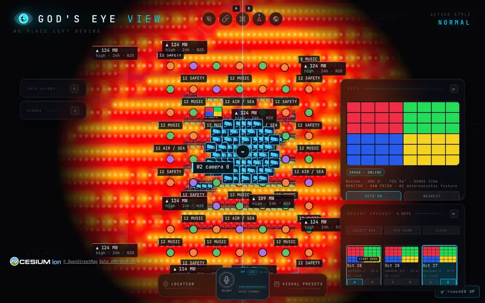
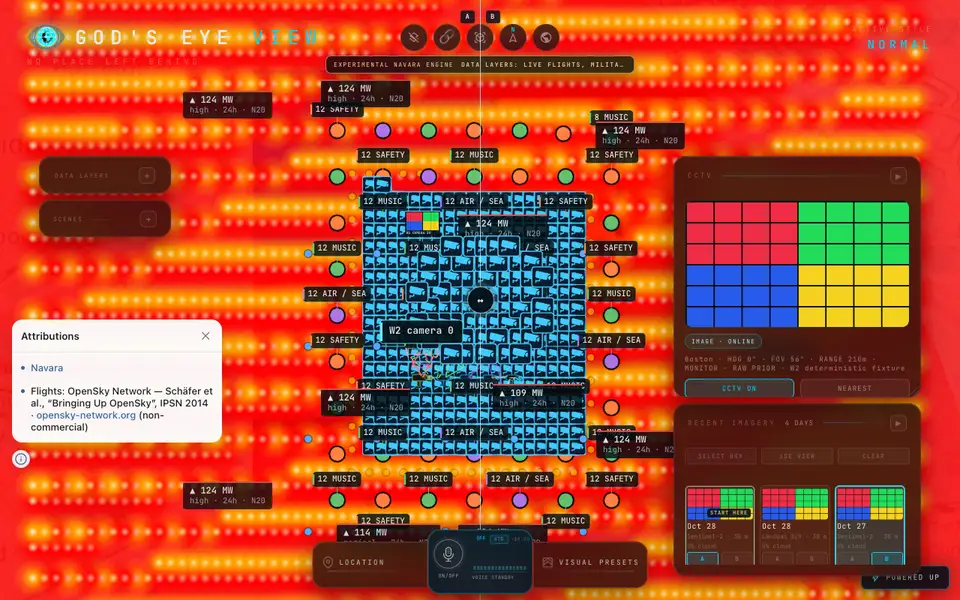

# W2: Navara / Cesium performance comparison

**2026-10-30 follow-up:** [MSAA investigation and repeated measurements](phase3-w2-msaa-performance.md). The optimized combined result is 14.6 ms Navara / 4.2 ms Cesium (3.476×); the controlled original-pipeline rerun is 18.1 ms. The 1.10 work gate still fails. The historical measurements below are retained unchanged.

Measured on 2026-10-29 after the W2 closure fixes. All nine W2 layers have implementation checkpoints. These measurements do **not** certify whole-wave acceptance: the original 1.10 limits remain binding and failed gates are listed below. Dioxus and the later migration phases are deferred.

In the current standard modes, the combined scene takes 4.2 ms Cesium/15.7 ms Navara (median uncapped workp95, ratio 3.738). Navara has not demonstrated a rendering-speed win. The lighter Navara-minimal diagnostic is 9.9 ms versus 4.6 ms Cesium; the pre-fix Navara diagnostic was 35.3 ms. Delivered smoothness and JavaScript memory are reported separately below.

## Reproducible conditions

- Host: Apple M 2 Pro, 12 cores, darwin/arm 64; Chrome/152.0.7977.75, headless Metal.
- The `look=` selector is implemented by Navara only. Cesium keeps its normal product look in both series. The minimal series is therefore a Navara diagnostic, not equal-effects parity; the cinematic series compares the two current standard modes. Screenshots retain the visible scope-mask and overlay-alpha differences.
- Both engines use the same keyless QA production build, 1280×800 canvas, DPR 1, OSM/terrain and fixed application clock. Google/Cesium credentials are empty at build and launch; paid map endpoints are blocked before navigation. Product defaults are unchanged.
- Boston nadir at 6 km, except the 3000 vehicle case at 30 km. Identical frozen provider-shaped payloads pass through the real parsers. All populations are asserted in every capture: 500 earthquakes worldwide (five near the camera), 6000 fires, 20 installations, 200 bike stations, 750 radio stations, 325 ALPR cameras, 25 CCTV cameras, 800 moving transit vehicles and two imagery dates.
- One discarded browser context and three measured contexts per engine and look/mode; each scene has 3 s warmup and 10 s capture. Runs are sequential Cesium/Navara pairs, with no concurrent GPU QA, builds or runtime edits. Tables report the median of the three per-run p95 values.
- The render governor holds both engines continuously active. Empty-scene throughput is not an idle-power measurement; the separate engine contracts verify render-on-demand rest.
- Work is the interval between engine preRender and postRender listeners: CPU/submission/backpressure, **not GPU timer queries or whole-page CPU**. Frame interval measures actual delivered frames. JS heap is measured after forced GC; it excludes GPU memory. Startup includes fixture/bootstrap/tile readiness and is descriptive, not an isolated cold-start benchmark.
- The migration bundle still contains both engine paths; this is not a standalone Navara build after Cesium removal. The same machine and only three measured runs limit generalization. Live providers and paid photoreal tiles were not tested; these results cannot predict Google 3D fetching, decoding or GPU-memory cost.
- Runtime checkpoint: `e0e593d66ced02cfded9ee834b80d1263ed5ca6c`; QA manifest SHA256: `36be4442a34d4f9ef53d693798aa06bb767f237549241cd729cb3381f2fd8ebf`. Raw captures include tracked diff, driver and fixture hashes.

## Diagnostic: Navara minimal / Cesium normal

| Scene | Work p95 C / N, ms | N/C work | Paced interval p95 C / N, ms | Long frames >33.4ms C / N | Work / paced gate |
|---|---:|---:|---:|---:|---|
| empty | 2.60 / 3.40 | 1.308 | 17.80 / 18.90 | 0 / 0 | FAIL / PASS |
| firms | 2.90 / 3.80 | 1.310 | 17.90 / 19.20 | 0 / 0 | FAIL / PASS |
| alpr | 3.30 / 4.50 | 1.364 | 18.10 / 19.10 | 0 / 0 | FAIL / PASS |
| cctv | 3.40 / 4.20 | 1.235 | 18.10 / 19.00 | 0 / 0 | FAIL / PASS |
| imagery | 3.00 / 4.40 | 1.467 | 18.00 / 19.00 | 0 / 0 | FAIL / PASS |
| transit800 | 2.90 / 4.60 | 1.586 | 18.60 / 19.20 | 0 / 0 | FAIL / PASS |
| transit3000 | 4.90 / 6.70 | 1.367 | 18.60 / 19.30 | 0 / 0 | FAIL / PASS |
| combined | 4.60 / 9.90 | 2.152 | 18.40 / 19.00 | 0 / 0 | FAIL / PASS |

One measured minimal-paced FIRMS run has three Navara frames above 33.4 ms versus zero Cesium; the other two have zero, so the existing median-based long-frame gate passes. This outlier is retained in the raw capture.

The gate compares Navara/Cesium at ≤1.10. Paced capture also requires Navara long-frame count ≤Cesium+2 per 10 s. Empty-scene and new per-layer series are informative comparisons; the established FIRMS and combined-wave requirements are not relaxed by them.

## Standard modes: Navara cinematic / Cesium normal

| Scene | Work p95 C / N, ms | N/C work | Paced interval p95 C / N, ms | Long frames >33.4ms C / N | Work / paced gate |
|---|---:|---:|---:|---:|---|
| empty | 3.00 / 7.20 | 2.400 | 18.70 / 18.80 | 0 / 0 | FAIL / PASS |
| combined | 4.20 / 15.70 | 3.738 | 18.40 / 19.20 | 0 / 0 | FAIL / PASS |

Cinematic images are visual review evidence, not exact whole-frame parity. Scope-mask/tone parity belongs to the later look migration; it has not been declared equivalent.

## Startup and retained JavaScript heap

| Look / mode | Ready C / N, ms | Combined heap C / N, MiB | Combined heap change C / N, MiB |
|---|---:|---:|---:|
| minimal-uncapped | 5877.0 / 6388.0 | 91.6 / 54.9 | 0.5 / 0.3 |
| minimal-paced | 6707.0 / 6157.0 | 90.7 / 52.9 | 0.4 / 0.1 |
| cinematic-uncapped | 6116.0 / 6884.0 | 91.9 / 54.2 | 2.1 / 0.3 |
| cinematic-paced | 6407.0 / 6873.0 | 91.0 / 52.6 | 1.8 / 0.3 |

## Review fixes and retained failures

- Installation contours originally cost 60 stencil draws for 20 separate meshes. Consecutive equal-material contours now merge only when conservative local bounds are disjoint. Overlaps, material changes and ordering remain separate. Combined pre-fix uncapped work was 5.8 ms Cesium/35.3 ms Navara; this earlier series has the same populations but precedes the final ordering/shader corrections, so it is historical evidence, not a controlled single-change attribution.
- Actual batch/unbatched proof: exact painted coverage, 21 RGB-different pixels among 4029 painted, maximum 58 channel delta, 0.244% aggregate colour error; deleting one contour fails the coverage gate. Exact RGB and the one-pixel-boundary-only hypothesis both failed and remain documented. No bit-identical claim is made.
- Fixed offscreen ground volumes entering edge candidate cells; fixed public effect teardown (`delete`); corrected imagery/ground/glyph ordering for all 48 activation/configuration permutations; fixed glyph-cache invalidation after context loss/restoration. Normal and always-visible shader variants now have distinct program keys. The program-key unit regression fails before the fix; the actual opaque-box browser probe passes both before and after, so it is only a rendering smoke proof.
- Final keyless browser checks: engine contracts 70/70 Cesium, 76/76 Navara; installations 12/12 and 7/7; contour batch/order 7/7; sprite colour/alpha 27/27; FIRMS glows 59/59; ground/opaque-box/point-depth 8/8. Both CCTV previews 31/31 pass with real volumes, stable resources, moving video pixels and zero-pixel paused negative control. Both keyless ALPR journeys pass with no long frames.
- Full final Node 24 gates: 7341 ordinary tests pass, one Windows-only skip; 15 allocation probes; boundaries, scoped formatting, production/panel/QA builds and main composition pass. Main chunk has no size baseline, so no byte-budget verdict is claimed.
- Dedicated FIRMS close gate is still open: earlier full uncapped ratio 1.136 versus 1.10, fresh one-context diagnostic 1.341 (4.4 ms Cesium/5.9 ms Navara). The Boston combined-driver FIRMS case is a different scene and does not overwrite that result.
- Ordinary production shell retains one delayed native idle frame and a 5.09 m height difference at an offscreen point. Matched direct terrain samples agree to ~0.0001 m; the one visible startup probe agrees within 0.01 m. The cause of the native resident-mesh query difference is unproven; neither original shell gate was waived.
- The initial Navara CCTV preview failed a centre-only video probe; the corrected probe covers the actual projected plane interior, retains the pixel threshold and adds a paused negative control. Initial native installation QA failed only the local optional token 404; shared pre-navigation blocking now prevents that request. Closure 3/4 comparison attempts were stopped during discarded warmups and are not accepted series.
- Remaining acceptance work: failed performance/shell gates and the broader sensor/dense/common-surface matrix. Free-terrain synthetic mesh checks do not certify paid Google roof geometry. W3/W4, Dioxus, Rust and Cesium removal are not part of this comparison.

## Reviewed visual samples

Lossy overview copies (142,548 bytes total); the original 1280×800 PNGs remain the pixel evidence. These pictures expose the current scope-mask/overlay differences rather than asserting parity.

Cesium normal:



Navara cinematic:



## Captures

With the keyless QA preview running on 4207, reproduce the standard paced comparison from the migration worktree:

```sh
rtk proxy env GOOGLE_MAPS_API_KEY= CESIUM_ION_TOKEN= /Users/h/.local/share/mise/installs/node/24.14.0/bin/node scripts/qa-w2-comparison.mjs --base-url=http://127.0.0.1:4207 --out=/private/tmp/gev-w2-recheck.json --preview --mode=paced --look=cinematic --scenarios=empty,combined
```

- [minimal-uncapped](phase3-w2-performance-minimal-uncapped.json) — SHA256 `0c0a2d82ce51b6fe5b100a5d7563001fa716c5131497880a5dd96fd4463e2b70`.
- [minimal-paced](phase3-w2-performance-minimal-paced.json) — SHA256 `c67ab9c5249f1e932c100c730b76ab18e97a9b3553dcd8887c19f9b1bdb36fe2`.
- [cinematic-uncapped](phase3-w2-performance-cinematic-uncapped.json) — SHA256 `e5a441433b91086b322b4793f041ed1d2758d141ba9289908d07f9b71eb11943`.
- [cinematic-paced](phase3-w2-performance-cinematic-paced.json) — SHA256 `120075bd115d0cb21a27d24065f60be5869eeda5b4c4bf5a92d4b4b36c5b15f4`.
