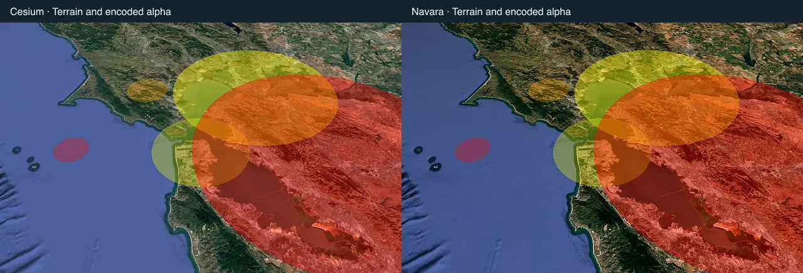
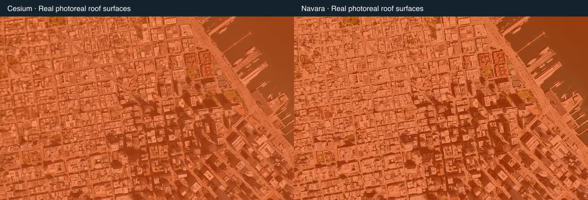

# Phase 3 W2 — execution report

Status: W2 in progress. Earthquakes are accepted on both engines; FIRMS and the remaining seven layers are pending. The initial checkpoint established the native oracle and fixed a shared overlay lifecycle defect. The execution sequence and later migration phases are in [the detailed plan](phase3-w2-plan.md).

## Reviewed changes

Removing a source entry previously removed its projection record but retained its collision arbiter identity. A later layout invalidation could then schedule frames for a label that no longer existed. Clear, individual remove and replace-empty now release that identity. Three regressions first failed on the old implementation (two unexpected render requests each), then passed. A fourth test proves another source in the same collision domain still paints. Existing live-source fade and collision policies are unchanged.

The new W2 driver feeds seventeen deterministic USGS-shaped features through the real parser, yielding fifteen valid earthquakes. Four camera poses require five visible fixed controls each, a fixed geometry epoch and actual nonempty globe pixels with all HUD/labels hidden. Ten enable/disable cycles retain owned resource counts; disabling leaves no analyst rows. The comparator rejects failed captures, late runtime errors, missing page observation, missing/nonfinite controls and changed capture/pose epochs. Eight CLI regressions exercise those rejection paths.

## Checkpoint evidence

Native dev and instrumented production preview each pass 18/18 checks with fifteen analyst rows, four nonempty disc rasters, ten toggles, no observed browser errors and zero rendered frames in the two-second disabled sample. Detection is explicitly switched OFF for that isolated idle sample; its starting mode was DENSE. This is a measurement precondition, not evidence that the unrelated Detection painter is idle in DENSE mode.

Both engine contracts pass (Cesium 73/73, Navara 80/80). Ordinary dev and production-preview shell checks pass on both engines (23/23 and 25/25), plus four cross-engine checks each, including share-link camera restoration. Only the exact known setup-status 404 is classified as expected on preview; no JavaScript/HTTP5xx errors are waived.

Production, panel and QA builds, main composition, package/import boundaries, scoped format and the required allocation suite pass. The final ordinary unit count is recorded in the compact evidence after the last comparator regressions. Raw capture artifacts and sanitized logs remain local under qa-artifacts/w2 and /tmp; hashes, populations and per-pose raster counts are in [the compact evidence](phase3-w2-evidence.json).

## Failed attempts and limits

The initial capture encountered a Vite outdated-optimize-dependency 504 after an accidental duplicate dev-start attempt invalidated its cache; the failed result is retained. Subsequent clean captures passed 17/18 but failed strict idle, including after the independent arbiter fix. Runtime traces identified active Detection painting; isolating it via its public OFF mode closed the sample. These failures are retained, not relabelled as passing runs.

The bootstrap checks established native ground discs only. W2-1b below records Navara acceptance; eight other layers and whole-wave acceptance are still pending.

## W2-1a — earthquake native renderer extraction

Accepted: the layer now owns plain geo/Rgba presentation and refresh/cancellation, with an injected render factory. The native renderer owns the original CustomDataSource, unchanged static ground ellipses and raw analyst snapshots. Standalone application defaults and the public data facade keep their native behavior. Destruction uses the renderer's original owner even if a caller supplies another viewer; repeated destruction is safe. The portable earthquake package has no external engine dependency, and import-direction checks now require all native drawing to stay in render/cesium.js.

Three new semantic regressions cover exact coordinates/radii/depth palette/alpha/identity and truncation, last-good geometry after a failed refresh, and correct destruction ownership. Together with existing source/lifecycle tests, full ordinary tests pass 7186/7187 (one Windows-only skip), all fifteen allocation checks pass, boundaries/scoped format and production/panel/QA builds pass. Main composition excludes Three/Navara from the native entry; there is no phase3 byte-budget baseline, so this does not claim a size-budget gate.

Dev and QA-preview each pass 18/18 earthquake checks. Both compare equal to the pinned native baseline for all fifteen records, fixed epochs and projected controls. All eight native dev PNGs (four poses, on/off) are byte-identical to the pre-extraction baseline. Review resolved the renderer-owned destruction case and kept every existing no-callback/no-continuous-hold source assertion, extending its scan to the extracted renderer. Only newly added blocks were restyled after scoped format found two differences; old formatting was preserved.

The configured outline fields remain in native entities. Cesium's installed GeometryUpdater explicitly disables outlines when onTerrain is true; Navara must match that actual image, not invent visible rings. W2-1b below implements classification on the real Navara terrain/3D-tile surface, with foreground mesh exclusion and horizon checks.

## W2-1b — Navara earthquakes

Accepted for this layer. A lazy public SDK post-effect classifies the actual visible terrain/Google-tiles depth. A separate public surface-depth mask excludes custom forward meshes. It preserves native 48-vertex footprints, source order, three depth colors and encoded-sRGB alpha, with camera-relative float64 preparation. No SDK modifications or new private hooks are used. Native ground outlines remain absent.

Initial GPU checks exposed real mismatches: hardware linear alpha produced brighter discs than native display-space blending, and a -12km volume floor excluded orbital terrain measured near -26km. Explicit display-space composition and the native conservative -100km floor resolve those cases. The screen-cell index retains every overlapping candidate; a 513-overlap regression proves it has no cell cap.

Static camera data is cached, with invalidation on camera, projection or viewport changes. Its regression first observed 102 texture versions where only 2 were needed. Large discs now binary-search the radial boundary edge and check its neighbors; small/subpixel discs retain all 48 supporting planes. Native geometry oracles cover 25 world/magnitude cases including poles, date line and M10. Switching fast/full/fast in the same actual GPU scene yields exactly zero changed channels in all four poses. An actual source-fed antipodal M10 is present in the analyst records and adds zero visible pixels.

Dev and QA-preview pass 25/25 native and 26/26 Navara checks: 15 analyst records, fixed epochs, five visible controls per pose, source failure/recovery, a cancelled late empty response, share restoration in both engine directions and ten toggle cycles. Enabled and disabled isolated samples each draw zero frames in two seconds. All three observed pages per capture have no runtime errors. Native's eight baseline on/off PNGs remain byte-identical. Earthquakes retain their existing noninteractive behavior; no selection/follow controls are invented.

Five actual photoreal surface probes are painted, including a real roof. A real opaque 200m custom cube masks the effect: its 32x32 interior has max RGB delta 0, with contrast 139 proving geometry is present. Removing only the mask through QA interception produces delta 81 and a genuine failed verdict. Normal production output has no QA-probe markers; injection exists only in the instrumented QA build or dev request interception.

Performance uses 500 parser-fed events, 1280x800/DPR1, minimal look, a discarded warmup and three fresh measured contexts per engine, three-second warmups and ten-second samples:

| Scene | Native work p95 ms | Navara work p95 ms | Work ratio | Paced interval ratio |
|---|---:|---:|---:|---:|
| Global |6.0|0.8|0.133|0.979|
| City |8.8|8.5|0.966|0.990|
| Orbit |7.0|5.5|0.786|1.037|

Both complete series pass the existing 1.1 ratios; paced long-frame counts above 33.4ms are zero for both engines. Earlier city failures (full 13.7 vs 8.7 ms and cache-only 13.2 ms) remain archived. These are observed engine pre/post-render work intervals, not GPU timer-query times. Default-look and combined-layer performance remain wave-closure tasks.

Review found that Navara attribution still listed only shell providers after W1. Canonical credits for available W1 feeds and USGS are now included. A failing unit regression proved the missing credits, and the actual Navara UI contains the USGS credit. Unsupported future layers remain excluded.

Final product checks: 7195/7196 ordinary tests pass with one Windows-only skip, 15/15 allocation checks, boundaries, 1575-file scoped formatting, production/panel/QA builds and main composition. Engine contracts pass 73/73 and 80/80. Dev and ordinary production shell pass on both engines, including cross-engine share checks. After diagnostic-only additions, 109 focused contract/fake-engine tests and boundaries/scoped format pass again. No production source changed after the frozen build/performance series.

Limits: the Transamerica centre probe reads 195.91m native versus 212.05m Navara; painted surfaces establish draping, not two-metre roof-height parity. Some before/after Navara background pixels differ; the same-context fast/full shader comparison isolates the optimization and is exact. Earlier bare Navara runs intermittently failed S5 idle and a line click; repeats pass, failure logs/diagnostics are retained, and no cause or picking fix is claimed. Main composition has no phase3 byte-budget baseline, so no size-budget gate is claimed. FIRMS proceeds under [its detailed plan](phase3-w2-firms-plan.md); W2/W3/W4/UI/Rust/Cesium-removal work remains open.

Reviewed lossy comparison images (193KB total; raw PNGs remain the pixel oracle):

## W2-2a — FIRMS native renderer extraction

Accepted on Cesium; the FIRMS Navara renderer is next. The portable layer retains source normalization, viewport/LOD policy, aggregation, DEM anchors, cards, analyst/context records and stable selection. The injected native renderer owns rectangles, translucent billboards, projection, horizon/picking/input and the original scene's disposal. Native collection teardown now unregisters its sprite identity. The portable fire-layer package has no external engine dependency; the import-direction guard enforces the new ownership.

The deterministic proxy fixture contains 371 valid detections and two invalid coordinate records, VIIRS/MODIS confidence, UTC acquisition clocks, a separate source receipt clock, three regions and pole/date-line cases. Five poses cover global/regional heat cells and local/close/terrain glows. The explicit DEM fixture is anchor test data, not live elevation accuracy evidence.

The initial 34/35 capture failed enabled idle. Traces showed Detection OFF and no render holds, with requests from chrome resize observers. DOM evidence identified the HUD summary typewriter widening its corner. That is legitimate UI animation; application observers were preserved. QA now supplies a fixed provenance-aware summary and waits for actual frame/text quiescence before the unchanged strict zero-frame sample. All failed captures remain retained.

Independently, the existing FIRMS settle timeout survived disable/destroy and duplicated requests after repeated moveEnd events. Three regressions failed on that code, while the active-layer final-frame control passed. The timer is now owned, cancelled on watcher removal and coalesced. All four tests pass. New geometry/color/sprite-policy, date-line/pole rectangle arithmetic and original-owner disposal checks bring the ordinary suite to 7203 tests: 7202 pass and one Windows-only test skips; all 15 allocation checks pass.

Native dev and QA-preview each pass 36/36: real parser and receipt clocks, five visible controls per pose, actual nonempty ground/sprite pixels, real pointer selection, one UI-owned focus transfer, canvas-painted selected card with one accessible action, source-order-independent selection, source failure/keyless/stale/recovery/cancellation, ten toggles and zero frames in both enabled/disabled two-second samples. Dev and preview both match the native baseline semantically, including exact rectangle geometry/colors/metadata. All ten on/off PNGs per build are byte-identical to the baseline. Close glows and regional cells were visually reviewed.

The strict comparator accepts the real baseline and rejects 19 independently corrupted captures, including missing observers, late errors, empty data/rasters, wrong clocks/controls/geometry and broken selection/idle. These sensitivity probes are separate from the Node unit count. Legacy FIRMS runs on explicitly selected headless Metal and passes 9/9 with no unexpected browser errors. Two exact intentional keyless-source 503 messages are classified, with all other errors retained.

Boundaries, scoped format (1582 files), production/panel/QA builds and main composition pass. The first full suite exposed an old camera-handoff source guard tied to a literal native event enum; the updated guard checks the injected event and actual native LEFT_CLICK owner, preserving sibling-pick/card ordering and the no-layer-camera-flight rule. Both engine contracts and dev/ordinary-preview shell regressions pass; native earthquakes retain 25/25 checks. No byte-budget baseline or live FIRMS provider acceptance is claimed. Next: actual Navara cells/glows, alpha/ground/pick/focus/share/lifecycle/performance proof and review under the detailed FIRMS plan.

## W2-2b — FIRMS Navara acceptance checkpoint (2026-10-28)

The Navara implementation and wiring are present but remain uncommitted because the close uncapped performance gate does not pass. Current evidence has 6000 parser-fed records in each engine, 3000 Navara sprite instances in the close pose, matching populations and no browser errors; close work p95 is 4.4ms native / 5.5ms Navara (1.25, limit1.10), with zero >33.4ms frames. The 64x40 ground candidate and alpha27/glows59 proofs, including default-sharpen parity, pass. The current full CPU/build gate list passes unit, boundaries, format, production, panel, QA preview and main composition.

An always-visible vertex-distance shortcut made no measurable difference and was reverted. An unsigned-byte glyph target broke default-sharpen color parity (orange/red source-aligned maxima3.14/3.40 versus limit3); it was reverted. The final rebuilt HalfFloat QA preview passes alpha27 and glows59. The new detailed plan records this blocker and retains both failed experiments. No threshold/population was changed and no Navara FIRMS acceptance commit was made. The next W2 step remains measured optimization of this close cost, followed by rerunning performance and final FIRMS review; military installations stay sequenced after acceptance.

## 2026-10-28 — W1 regression confirmation

The current uncommitted source passed all 46 jobs in the W1 regression runner: uncapped and paced fleet/vessel budgets, satellite uncapped budget, pixel captures, engine contracts, dev/production shell and cross-engine share parity, gestures, all W1 layers and comparisons on dev/preview, quake checks, and the ground-own-mesh probe. Every recorded exit code is zero. The browser source record is pinned to HEAD `028beb8f75ad354245fb8c046ae0b146ee102a8e` and diff SHA-256 `739691900dcfa7b5e4421364c5b82db71612e5fcd29e0c9dd40b0472c9c7e17d`; reports and logs are under `/tmp/gev-w2-firms-regressions-front-side-confirm/`.

The dedicated close FIRMS budget remains the known acceptance blocker: 4.4ms Cesium / 5.5ms Navara work p95 (1.25; limit1.10). W1 regressions passing does not replace this gate or accept the FIRMS renderer. No commit has been made.

## 2026-10-28 — FIRMS close budget follow-up

A fresh QA-preview diagnostic on the unchanged source measured 4.3ms Cesium / 5.4ms Navara close work p95 (1.256 against the existing1.10 limit), with 6000 records, 3000 Navara instances, and zero long frames. The dedicated FIRMS acceptance remains blocked. A per-render GPU query probe returned non-disjoint results for the instanced sprite scene and encoded composite, but those pass durations did not reconcile with the full-frame measurement; they are not treated as reliable cost attribution. No code or gate changed.

## 2026-10-28 — matched FIRMS renderer timing probe

A QA-only wrapper measured synchronous Three `renderer.render` calls in the same Navara close scene before and after disabling FIRMS. The main scene kept 222 direct children; its call p50/p95 shifted from3.6/5.0ms with FIRMS to0.2/0.5ms without it. The 3000-instance sprite draw and encoded full-frame composite calls each remained at or below0.1ms p95 on the CPU timer. This points to graphics-driver/GPU back-pressure while the layer is active, but does not identify which GPU pass causes it. A synchronized per-pass GPU timer probe returned zero for all draws despite `disjoint=false`; that probe is invalid and is retained only as a failed diagnostic. Raw paired captures and summaries are in `qa-artifacts/w2/firms/navara/glyph-target-performance/on-off-render-cpu-profile/`. No renderer change is accepted from these probes.

## 2026-10-28 — FIRMS overlay isolation

In the same Navara close scene, work p95 was5.4ms normally,5.3ms with `colorWrite=false` on the 3000-instance mesh, and4.4ms with that mesh hidden. The color-write control retains the sprite mesh and composite pass; the hidden control makes the overlay pass return early. This attributes about0.9ms to the active overlay path as a whole, but does not separate sprite shader/raster work from the full-frame composite. QA-only state was restored after each sample. Raw result: `qa-artifacts/w2/firms/navara/glyph-target-performance/on-off-render-cpu-profile/sprite-color-isolation.json`. No product change or gate change.

The same close diagnostic read back the live HalfFloat glyph target:594,865/1,024,000 pixels had nonzero alpha (58.1%), within x269–1076 and the full target height. This establishes that the encoded overlay touches only about63% of target width in this pose and gives a concrete bound for a possible clipped composite. A copy-plus-scissor path would still need to prove exact output pixels and a net performance gain. This is diagnostic evidence only; the static preview also reported the expected missing `/api/setup/status` endpoint, so the run is not an acceptance gate. Raw capture: `qa-artifacts/w2/firms/navara/glyph-target-performance/on-off-render-cpu-profile/overlay-target-coverage.json`.

## 2026-10-28 — bounded FIRMS compositor experiment (rejected)

Using measured close-pose glyph coverage (about 63% of the target), a QA-preview candidate copied the scene buffer and scissored the encoded composite. Alpha and FIRMS glow pixel suites passed after the change (27/27 and 59/59), but close work p95 remained over budget: native 4.4ms/Navara 5.3ms, ratio 1.205 against 1.10. A follow-up bounded glyph-target clearing and used rotated sprite extents; pixel proofs still passed, while performance measured native 4.4ms/Navara 5.4ms, ratio 1.227. Both measurements used one measured context per engine and are diagnostics, not acceptance. The candidate was reverted because it did not provide a repeatable budget improvement. Full-frame compositing remains unchanged; captures are retained under `qa-artifacts/w2/firms/navara/scissor-*`.

## 2026-10-28 — FIRMS visible-instance diagnostic

A QA-only wrapper around the public mover-set API measured all 3000 close-pose FIRMS sprite instances as visible after horizon culling. Compacting hidden instances therefore has no close-pose draw-count benefit. This one-context preview diagnostic measured native 4.3ms/Navara 5.6ms (ratio 1.302), reinforcing that these short samples vary and cannot accept the layer. Capture: `qa-artifacts/w2/firms/navara/visible-instance-diagnostic-final.json`. The optional wrapper was removed from the QA driver after the measurement.

## 2026-10-28 — FIRMS static glyph-target cache (not accepted)

A full-resolution HalfFloat glyph target was cached for stationary, sharpened, always-visible sprite sets. The cache invalidates on camera, target-size, instance/geometry/material/texture, and context changes. QA instrumentation observed 3928 cache hits, two redraws, and no non-cacheable frames in a close sample. Alpha 27/27 and glow/sharpen 59/59 pixel checks passed on the full-resolution target. A 75% target-resolution variant passed alpha geometry but failed the strict RGB profile for yellow, orange, and red glows; that variant was reverted.

The full three-context uncapped series with the full-resolution cache passes global (ratio 0.946), regional (0.982), and local (0.773), but close remains 5.0ms Navara / 4.4ms Cesium (1.136; required <=1.10). A second full uncapped run confirmed the same close result. The three-context paced series passes all poses, including close at 1.068, with zero long frames. The cache is not accepted until uncapped close passes. A local implementation checkpoint may be committed while this gate remains open; that commit does not accept FIRMS. Raw reports are currently under `/private/tmp/gev-w2-firms-cache-*`; the acceptance threshold and population remain unchanged.

## 2026-10-28 — current FIRMS preview revalidation and bounded compositor probes

The current full-resolution/HalfFloat/exact-sRGB implementation was rebuilt into an isolated QA preview on port 4206. Preview checks pass alpha/sprite profiles 27/27, glow/sharpen profiles 59/59, FIRMS functional acceptance 39/39 on each engine with cross-engine comparison, ground/limb proof 26/26, and the existing legacy fixture acceptance 9/9 on each engine. The legacy runner now opts into only the shared exact `/api/setup/status` 404 preview exception; its four intentional keyless-source errors remain separately expected. There are no other accepted preview errors. Production, panel, QA-preview builds, boundaries, scoped formatting (1600 files), and main-chunk check pass. Fifty focused tests across the changed layer/rendering files pass. A repeat full `npm test` invocation did not finish in its long-running window and was manually interrupted, so that repeat is not counted as a pass; an earlier full run on the same renderer/source changes passed.

The exact-sRGB full-resolution cache still has the prior three-context uncapped result: global0.946, regional0.982, local0.773, close1.136 (5.0/4.4ms; limit1.10). Degree-eight transfer polynomials passed pixels but a full three-context run worsened close to1.159; degree-seven also passed pixels but did not improve the one-context close ratio (1.114), so both were reverted to exact sRGB. A three-vertex fullscreen composite passed glow pixels but produced no measurable close improvement (one-context1.136) and was reverted to the original fullscreen quad. A final QA-preview composite-control sample observed 4,779 cache hits,4 redraws,0 unavailable frames; toggling display-space blending off measured 5.4ms versus5.2ms with it enabled, so this single-context result does not isolate or justify a new optimization. All fixture populations, color tolerances, and the1.10 gate are unchanged. FIRMS remains pending its uncapped close gate; no acceptance is claimed.

Local checkpoint commit: `35283237 feat(firms): add Navara renderer checkpoint`. The next W2 layer plan is [military installations](phase3-w2-installations-plan.md). FIRMS' performance gate remains a wave-closure requirement while independent W2 renderer work continues.
