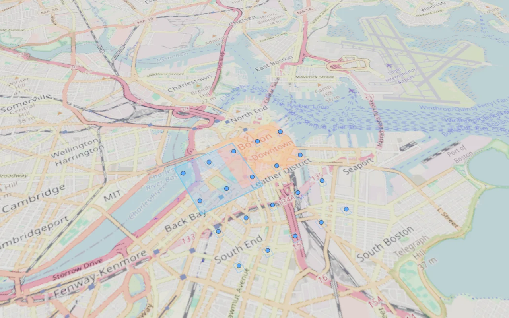

# Navara stencil optimization — 2026-10-30

Follow-up: [empty-scene resolve optimization](phase3-w2-empty-renders-performance.md) removes a redundant MRT resolve, with a 22% base-map improvement and only a small combined-scene gain in its fresh controlled series. The measurements below remain historical.

Combined-scene median uncapped work p95 falls from **11.9 to 9.1 ms (23.5%)** against the original stencil path on the same build. Cesium measures **4.0 ms**, giving **2.275×** Navara/Cesium, down from **2.975×** for the control. Installation-only cost falls **27.1%**, from **9.6 to 7.0 ms**. All three optimized samples beat all three control samples in each scene. The original **1.10 budget still FAILS**; this is an optimization checkpoint, not W2 acceptance.

Runtime commit: `e60f668cd5372e9ac759e5b4e351f231bfa5e1b6`. No SDK patches, Dioxus changes, app-default changes, subagents, pushes or publication. Tests and builds used empty Google/Cesium keys; browser policy blocked paid map endpoints before navigation.

## Change and quality

Navara's public `DrapedMesh.process` performs three stencil draws via three `renderer.render()` calls. Three resolves the complete multisampled MRT after each call, even when colour writes are disabled. The new installation helper captures the SDK's three material states, then submits three persistent child meshes in one render. It removes two intermediate MRT resolves per volume while retaining all stencil draws, their order, shaders, geometry, depth rules and **4× geometry MSAA**. It applies to installation fills and outlines.

Materials retain shader hooks/defines and follow source versions, colour, opacity and stencil masks. Children borrow the current batch geometry, are attached only during rendering, and preserve the original transform. Owned materials dispose with their source; borrowed geometry is not disposed. Render exceptions restore ownership. Unexpected child/material configurations use the original path. Navara remains pinned to 0.2.1; revalidate public process semantics and ordering on SDK upgrades.

The final same-page oracle compares original and optimized canvas pixels in a fixed **850×460 region**: **0 changed RGB pixels** for the real catalog/CCTV scene and for overlapping translucent fills, a polygon hole and outlines at three camera orientations. Repeating the original frame is also exact. Removing geometry changes 5,692 catalog pixels and 36,199–77,953 custom-scene pixels; filling the hole changes 5,002 pixels. These negative controls prove the checked geometry is visible. This establishes regional equivalence for these cases, not universal whole-frame equivalence.

The catalog retains 247 GPU draws while public render submissions fall 42→40. The three custom views retain 70/121/89 draws while submissions fall 47→41, 50→42 and 50→42. Counts include all visible scene passes and depend on the loaded terrain.

An earlier oracle had an incorrectly aimed oblique camera and captured the full page; one case differed by 260 pixels at one RGB level. Its cause was not established. The final test corrects targeting, captures the canvas, verifies A/A stability and checks visible geometry in every pose. The strict zero-difference threshold was retained; earlier evidence is preserved.



## Measurements

M2 Pro/12-core host, Chrome 152 headless Metal, 1280×800 DPR1, cinematic look, fixed application clock, cached free OSM/terrain and unchanged W2 fixture. One context per variant is discarded, followed by three measured contexts, each with 3 s warmup and 10 s capture per scene. Uncapped runs cycle Cesium then both Navara variants; the Navara order reverses in measured run 1. Paced runs alternate Cesium and optimized Navara. Own GPU jobs are sequential, with no concurrent builds or runtime edits.

`--stencil-pairs` restores the public prototype `process` on actual installation meshes for the control. Both paths keep the previous MSAA optimization. All runs use the committed runtime, empty tracked diff, identical fixture/driver and QA manifest `de92bc548c2b130388e9b465dc8c4de9612d511a77b9953419b80de34e5dd87d`. Counts and moving transit are asserted in every capture; all final browser-error arrays are empty. This is a warm-render comparison, not a cold-start benchmark.

| Scene | Original stencil samples, ms | Optimized samples, ms | Median original → optimized | Reduction | Cesium median, ms | Optimized N/C |
|---|---|---|---:|---:|---:|---:|
| installations | 10.0, 9.6, 9.4 | 6.9, 7.0, 7.3 | 9.6 → 7.0 | 27.1% | 2.7 | 2.593 FAIL |
| combined | 12.0, 11.9, 11.8 | 9.1, 9.6, 9.1 | 11.9 → 9.1 | 23.5% | 4.0 | 2.275 FAIL |

| Paced scene | Interval p95 C / N, ms | Frames/10 s C / N (distinct measured counts) | Frames >33.4 ms C / N | Gate |
|---|---:|---|---:|---|
| installations | 18.5 / 19.1 | [600, 601] / [600] | 0 / 0 | PASS |
| combined | 18.1 / 18.9 | [600, 601] / [600] | 0 / 0 | PASS |

The metric is **CPU/submission/backpressure duration from preRender to postRender**, not isolated JavaScript or GPU time. Existing cinematic effect chains differ between engines. The previous session's 14.6 ms Navara / 4.2 ms Cesium and the earlier 3.7× headline are historical, not today's causal control. The controlled improvement here is 11.9→9.1 ms; do not attribute cross-session differences entirely to this patch. No GPU memory or energy reduction is measured.

The combined workload still contains 500 worldwide earthquakes (five local), 6,000 fires, 20 installations, 200 bike stations, 750 radio stations, 325 ALPR cameras, 25 CCTV cameras, 800 moving/shown transit vehicles and two imagery dates.

## Review and validation

- Full Node24 suite: **7,349 passed**, one Windows-only skip; **15 allocation probes** passed. Four new regressions cover native states, geometry/transform/shader preservation, live changes, stable resource reuse, teardown and exception recovery.
- Boundaries, scoped formatting, production/panel/QA builds and main-chunk composition pass. Main size acceptance remains unavailable without its pre-existing baseline. A direct QA geometry entry initially leaked Three into the initial graph; a lazy QA-only entry fixes the guard. No old code was reformatted.
- Final browser checks: stencil **18/18**; previous batch/order oracle **7/7**; installation layer **Navara 7/7, Cesium 12/12**; previous MSAA oracle **4/4**; Navara engine/lifecycle contracts **76/76**. Final captures have no unexpected browser errors.
- The uncapped driver exits **1 solely for the retained 1.10 performance budget**; all captures complete. Paced exits **0**. No gate was weakened.
- Local review found no remaining ownership/order defect in this change. Paid photoreal geometry was deliberately not tested. Earlier W2 FIRMS/shell/common-surface gaps remain open; Dioxus remains deferred.

## Evidence and reproduction

- [Uncapped three-way comparison](phase3-w2-stencil-uncapped.json), SHA256 `38bc45f6105d4f4d5744dc78de76c2d984d362083e545682d595268ceb5eb98d`.
- [Paced comparison](phase3-w2-stencil-paced.json), SHA256 `a4c4291479173bbeebf964068bd33bf77a2d65a2a0d8513b06d382ce75bcbd9f`.
- [Gates, exact-pixel checks, earlier failed oracle and review evidence](phase3-w2-stencil-evidence.json).
- [Catalog screenshot](phase3-w2-stencil-catalog-optimized.webp). Lossless PNG oracles and full logs remain in `/private/tmp/gev-stencil-final-*`; WebPs are review illustrations.

With the owned keyless QA preview on 4207, run from the migration worktree:

```sh
rtk proxy env GOOGLE_MAPS_API_KEY= CESIUM_ION_TOKEN= node scripts/qa-installation-stencil.mjs --base-url=http://127.0.0.1:4207 --out=/private/tmp/stencil-pixels.json
rtk proxy env GOOGLE_MAPS_API_KEY= CESIUM_ION_TOKEN= node scripts/qa-w2-comparison.mjs --base-url=http://127.0.0.1:4207 --out=/private/tmp/stencil-uncapped.json --preview --look=cinematic --scenarios=installations,combined --stencil-pairs
rtk proxy env GOOGLE_MAPS_API_KEY= CESIUM_ION_TOKEN= node scripts/qa-w2-comparison.mjs --base-url=http://127.0.0.1:4207 --out=/private/tmp/stencil-paced.json --preview --look=cinematic --scenarios=installations,combined --mode=paced
```
