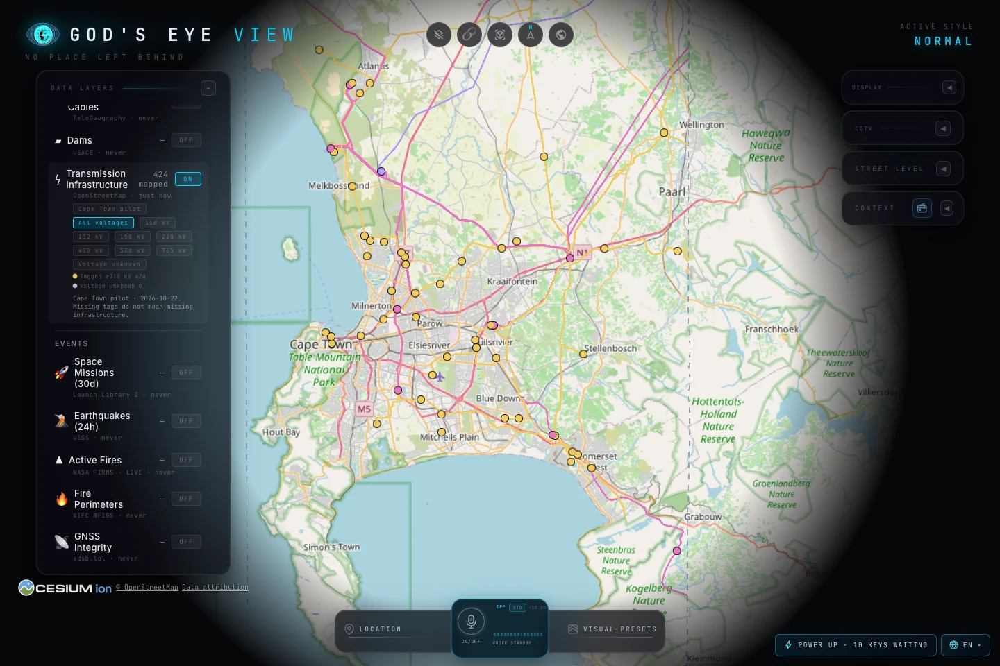
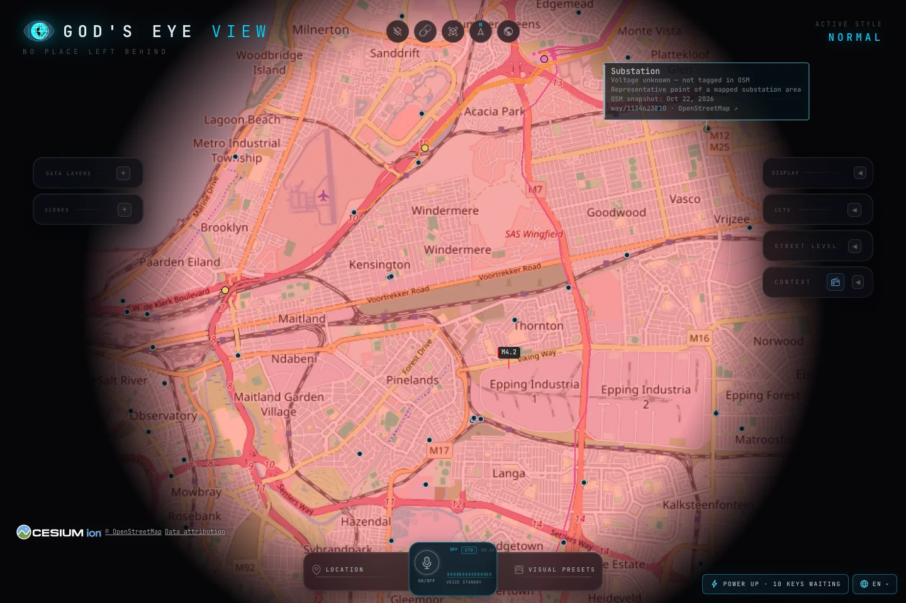

# Transmission pilot validation

The Cape Town pilot uses OpenStreetMap data from **2026-10-22**. It describes
mapped infrastructure within a rectangular coverage area, not live network
status. The unknown-voltage objects are not confirmed transmission substations.

## Data reproduction

The pinned `south-africa-261022.osm.pbf` passed its published MD5 check. Two
independent executions of `scripts/transmission/extract.py` produced byte-for-byte
identical `cape-town.geojson` and `source.json` files under Python 3.12.10,
osmium 4.3.2, Shapely 2.2.0 and pyproj 3.8.0.

| Measurement | Result |
| --- | ---: |
| Tagged line records | 367 |
| Tagged substations | 57 |
| Optional unknown-voltage substations | 418 |
| Clipped, simplified line length | 1,011.149 km |
| Line vertices | 1,762 |
| GeoJSON bytes | 251,785 |
| gzip-9 bytes | 32,347 |

The extractor checks source identities, resolves source substation relations
before excluding them spatially, and flags the one untagged node inside a
separately mapped lower-voltage area. Fixture tests cover clipping, voltage
parsing, representative points, overlap provenance and deterministic ordering.
The [extraction README](../scripts/transmission/README.md) gives reproduction
commands, scope and data licensing details.

## Browser checks

`node scripts/qa-transmission.mjs --url http://127.0.0.1:4181` passed against
the real application, live keyless basemap and terrain. It confirmed lazy loading,
actual ground-line picking, source-card selection, unknown-voltage controls,
voltage filtering, display limits, outside-coverage state, global zoom behavior,
resource cleanup, cached re-enable and share-link restoration. No page exceptions
were observed. A synthetic earthquake exercises coexistence; it is not a real
hazard report.

Regional view with the layer's normal controls and tagged records:

Close view with optional unknown-voltage markers and a selected OSM area. **The
red earthquake overlay is a synthetic QA fixture, not an actual event.**

Local smoke measurements on macOS arm64, headless Chromium 152, ANGLE Metal /
Apple M1 Max, 1440 × 960 viewport:

| Measurement | Layer off | Layer on |
| --- | ---: | ---: |
| Regional driven frame interval, median | 16.8 ms | 16.7 ms |
| Regional driven frame interval, p95 | 18.6 ms | 18.3 ms |
| GC-requested JS heap | 159.4 MB | 163.5 MB |

Each timing sample contains 89 intervals from 90 driven frames. Local pack load
and data-source admission took 18.8 ms; this is not time to fully rendered
geometry. Heap after disable was 154.9 MB, after camera/scene changes, so it is
not an isolated memory-retention measurement. Unit tests separately assert
release of rendered data sources, handlers, camera listeners, credit ownership
and selected cards. The small parsed pack deliberately remains cached until
layer destruction. These measurements are a local regression smoke check, not
cross-device performance guarantees.
